# REST API Programming – Complete Technical Training Guide

## Course Overview

REST API programming is one of the most important skills in modern software development. Almost every modern application, including mobile applications, web applications, enterprise systems, cloud platforms, and microservices, communicates with other systems through APIs.

This training guide introduces API concepts from the fundamentals and gradually progresses towards professional API design, implementation, security, documentation, and testing.

### Learning Objectives

By the end of this course, learners should be able to:

1. Understand how client-server communication evolved from traditional server architectures to modern API-based communication.
2. Explain REST, GraphQL, and other modern API communication approaches.
3. Understand API terminology, architecture, roles, responsibilities, and contracts.
4. Design REST APIs using appropriate HTTP methods, status codes, resource naming conventions, and response structures.
5. Understand API-first and code-first development approaches.
6. Design APIs for existing legacy systems.
7. Implement API security using authentication, authorization, OAuth 2.0, and JWT.
8. Understand OpenAPI 2.0 (Swagger 2.0) and OpenAPI 3.0 specifications.
9. Apply the Richardson Maturity Model to evaluate REST API maturity.
10. Work with JSON and JWT tokens in real-world applications.
11. Test APIs and validate their contracts.
12. Understand modern API architecture and the future direction of API development.

### Suggested Training Duration

| Module | Topic | Suggested Duration |
|---|---|---:|
| 1 | Introduction to REST API Programming | 2 hours |
| 2 | Designing APIs – Concepts and Contracts | 3 hours |
| 3 | API Design, Security and Standards | 3 hours |
| 4 | OpenAPI and Richardson Maturity Model | 2 hours |
| 5 | API Mechanics – JSON and JWT | 3 hours |
| 6 | Hands-on API Design and Implementation | 3 hours |
| **Total** | | **16 hours** |

---

# MODULE 1: INTRODUCTION TO REST API PROGRAMMING

## 1.1 What Is an API?

API stands for **Application Programming Interface**.

An API is a mechanism that allows two software applications to communicate with each other through a predefined set of rules and operations.

Think of an API as a waiter in a restaurant.

Imagine you visit a restaurant in Bengaluru.

1. You sit at a table and look at the menu.
2. You tell the waiter what you want.
3. The waiter communicates your request to the kitchen.
4. The kitchen prepares the food.
5. The waiter brings the prepared food back to you.

You do not enter the kitchen or need to understand how the food is prepared.

An API works similarly.

| Restaurant Concept | API Equivalent |
|---|---|
| Customer | Client application |
| Menu | API documentation |
| Waiter | API endpoint/interface |
| Kitchen | Backend application |
| Ingredients and preparation | Business logic and database operations |
| Prepared food | API response |

The client does not need to know how the server internally processes a request. It only needs to understand the API contract.

### Technical Definition

An API defines:

- What operations can be performed.
- What input data must be provided.
- How requests should be formatted.
- What response the client can expect.
- How errors should be communicated.
- What authentication and authorization are required.

### Example: Employee Management Application

Consider an organization that maintains employee records.

A web application wants to retrieve employee information from a backend system.

The frontend sends:

```http
GET /api/employees/101 HTTP/1.1
Host: api.company.in
Accept: application/json
```

The server processes the request and responds:

```http
HTTP/1.1 200 OK
Content-Type: application/json
```

```json
{
  "employeeId": 101,
  "employeeName": "Rahul Sharma",
  "city": "Bengaluru",
  "department": "IT"
}
```

The frontend receives the response and displays Rahul's information.

The frontend does not need to know whether the backend uses SQL Server, MongoDB, or DynamoDB.

### Real-World Example

An employee management application might use the following APIs:

| Requirement | API |
|---|---|
| Retrieve employees | GET /api/employees |
| Retrieve one employee | GET /api/employees/101 |
| Add an employee | POST /api/employees |
| Update employee details | PUT /api/employees/101 |
| Delete an employee | DELETE /api/employees/101 |


---

## 1.2 Brief History of Server Communication

To understand REST APIs, it is important to understand how applications communicated before modern API architectures became popular.

Software architecture has evolved considerably over the years.

### 1.2.1 Traditional Mainframe Architecture

During the early days of enterprise computing, organizations primarily used centralized mainframe computers.

All important business processing happened on a central computer.

Users accessed the system through terminals.

The terminals were generally responsible for accepting input and displaying output, while the mainframe performed most of the processing.

**Analogy:**

Imagine a large bank with a central headquarters. Every branch sends its transactions to the headquarters, and the headquarters processes everything.

This is similar to a centralized mainframe architecture.

**Characteristics:**

- Centralized processing.
- Limited client-side functionality.
- Expensive hardware.
- Strong dependence on the central server.
- Communication through terminal-based protocols.

**Real-World Example:**

Traditional banking systems used centralized mainframes to process account transactions, withdrawals, deposits, and other financial operations.

### 1.2.2 Client-Server Architecture

With the growth of personal computers and networking, applications started adopting client-server architecture.

The responsibilities were divided between two major components:

1. Client: Provides the user interface and initiates requests.
2. Server: Processes requests, performs business operations, and interacts with databases.

A client could communicate with a server over a network.

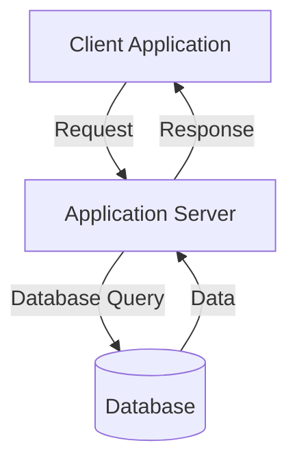

**Advantages:**

- Better separation of responsibilities.
- Multiple clients could access the same server.
- Business logic could be centralized.
- Data management became easier.

**Limitations:**

- Clients could become tightly coupled to server implementation.
- Different platforms sometimes required different communication mechanisms.
- Scaling the application could become difficult.

**Real-World Example:**

A desktop application installed in different branches of an organization connects to a central SQL Server database through an application server.

### 1.2.3 Distributed Architecture

As applications became larger, organizations started distributing application responsibilities across multiple servers.

Instead of maintaining one large application server, different services could perform different business functions.

For example:

- Employee Service manages employee records.
- Payroll Service processes salaries.
- Attendance Service tracks employee attendance.
- Notification Service sends emails and messages.

These services communicate with one another through network protocols.

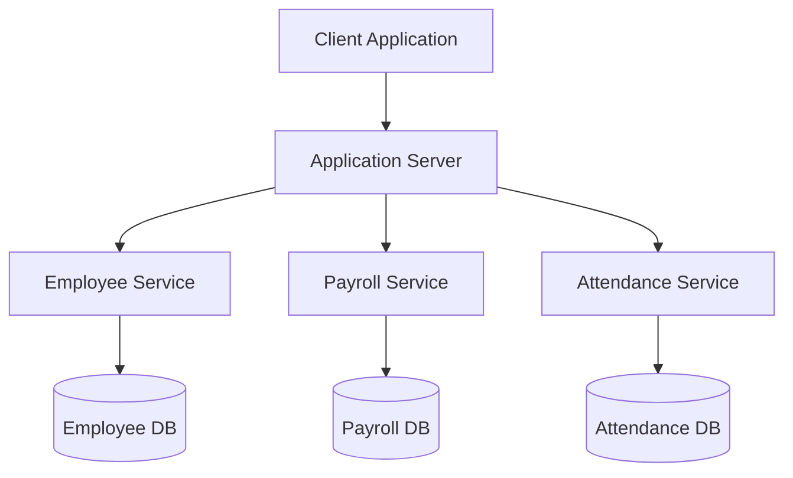

This architecture introduced new challenges around communication, service availability, data consistency, and network failures.

### 1.2.4 Web-Based Communication

The growth of the internet introduced HTTP as a widely adopted protocol for communication between web browsers and web servers.

Initially, websites primarily delivered HTML pages.

The browser requested a page, and the server returned HTML content.

Later, applications began exchanging structured data independently of HTML pages.

XML and JSON became important formats for exchanging data between applications.

This evolution created the foundation for modern web APIs.

### Real-World Example: Evolution of an Online Banking Application

| Architecture | Banking Application |
|---|---|
| Mainframe | All banking operations handled centrally |
| Client-Server | Branch applications communicate with a central server |
| Distributed | Separate systems handle accounts, payments, and loans |
| Web-Based | Customers access banking through browsers |
| API-Based | Mobile, web, and partner applications consume common APIs |


---

## 1.3 Past Roadmap – Evolution of Application Communication

Different technologies have been introduced to enable communication between applications.

Understanding these technologies helps explain why REST became popular.

### 1.3.1 Remote Procedure Call (RPC)

RPC stands for Remote Procedure Call.

It allows one application to execute a function or procedure located in another application or machine.

From the developer's perspective, calling a remote function can look similar to calling a local function.

**Analogy:**

Imagine calling a colleague in Chennai and asking them to execute a task on your behalf. You provide the required information, and they perform the operation and communicate the result.

RPC follows a similar approach.

Example:

```text
GetEmployee(101)
```

The client invokes a remote operation called `GetEmployee`.

The server processes it and returns the employee details.

**Advantages:**

- Easy-to-understand function-based communication.
- Suitable for structured service operations.
- Can provide strongly defined interfaces.

**Limitations:**

- Client and server may become tightly coupled.
- Remote failures are different from local function failures.
- Different RPC frameworks may require different communication protocols.

### 1.3.2 SOAP – Simple Object Access Protocol

SOAP is a messaging protocol used for exchanging structured information between applications.

It traditionally uses XML as its message format and defines a formal structure for requests and responses.

SOAP services often use WSDL (Web Services Description Language) to describe available operations and message contracts.

Example SOAP request:

```xml
<?xml version="1.0" encoding="UTF-8"?>
<soap:Envelope
    xmlns:soap="http://schemas.xmlsoap.org/soap/envelope/">

    <soap:Body>
        <GetEmployee>
            <EmployeeId>101</EmployeeId>
        </GetEmployee>
    </soap:Body>

</soap:Envelope>
```

A SOAP response might look like:

```xml
<soap:Envelope
    xmlns:soap="http://schemas.xmlsoap.org/soap/envelope/">

    <soap:Body>
        <GetEmployeeResponse>
            <EmployeeId>101</EmployeeId>
            <EmployeeName>Rahul Sharma</EmployeeName>
            <City>Bengaluru</City>
        </GetEmployeeResponse>
    </soap:Body>

</soap:Envelope>
```

**Important SOAP characteristics:**

- SOAP defines a formal messaging structure.
- XML is the standard message representation.
- WSDL can describe service operations and contracts.
- SOAP supports standards for enterprise messaging and security.
- SOAP messages can be transported over HTTP and other protocols.

### 1.3.3 XML-RPC

XML-RPC allows applications to execute remote procedures using XML-formatted messages.

It is simpler than SOAP but follows the same general RPC concept.

A client sends an XML request describing the method and its parameters. The server executes the requested method and returns an XML response.

### 1.3.4 REST

REST stands for Representational State Transfer.

It is an architectural style introduced by Roy Fielding in his 2000 doctoral dissertation.

REST uses resources, representations, and a uniform interface to enable communication between distributed systems.

REST is commonly implemented over HTTP.

Example:

```http
GET /api/employees/101
```

The request identifies an employee resource and asks the server to retrieve its representation.

### Comparison of Communication Approaches

| Technology | Communication Model | Typical Format | Common Use |
|---|---|---|---|
| RPC | Remote procedure invocation | Binary or framework-specific | Internal service calls |
| SOAP | Structured messaging | XML | Enterprise integrations |
| XML-RPC | Remote procedure invocation | XML | Legacy integrations |
| REST | Resource-oriented | JSON, XML, others | Web and mobile APIs |
| GraphQL | Query-oriented | JSON | Flexible client data retrieval |

### Real-World Example

Suppose a bank has an older SOAP-based loan management system but a new mobile application.

The organization can expose a REST API in front of the existing SOAP service. The mobile application communicates using JSON, while the backend adapter translates requests into SOAP messages.

This allows the organization to modernize its client applications without immediately replacing the existing system.

---

## 1.4 Modern API Options

Modern application development provides multiple ways to expose and consume application functionality.

The most common approaches include REST, GraphQL, and gRPC.

### 1.4.1 REST

REST is an architectural style rather than a communication protocol.

REST APIs generally use HTTP methods to operate on resources.

A resource represents an identifiable business entity or concept.

Examples:

- Employee
- Customer
- Order
- Product
- Payment

Each resource is identified through a URI.

Example:

```http
GET /api/employees/101
```

The API retrieves employee 101.

```http
POST /api/employees
```

The API creates a new employee.

**Important REST constraints:**

1. Client-Server: The user interface and backend responsibilities are separated.
2. Statelessness: Each request contains the information necessary for the server to process it. The server does not depend on conversational session state stored between requests.
3. Cacheability: Responses should indicate whether they can be cached.
4. Uniform Interface: Resources are accessed using consistent identification and representation rules.
5. Layered System: Clients need not know whether they are communicating directly with the application server or through gateways and intermediaries.
6. Code on Demand (Optional): A server may provide executable code to a client, although this constraint is rarely used in typical REST APIs.

A system satisfying these constraints is considered RESTful.

**Important distinction:** An HTTP endpoint that returns JSON is not automatically a fully REST-compliant API.

### 1.4.2 GraphQL

GraphQL is a query language for APIs and a runtime for executing those queries against data.

It was developed at Facebook and publicly released in 2015.

Unlike traditional REST APIs, where the server generally determines the response structure, GraphQL allows the client to request specific fields.

Consider an employee object containing:

- Employee ID
- Employee name
- Department
- City
- Email
- Phone number
- Address

A REST endpoint might return all these fields even when the client only needs the employee name and department.

A GraphQL query can request only the required fields.

Example:

```graphql
query {
  employee(id: 101) {
    employeeName
    department
  }
}
```

Example response:

```json
{
  "data": {
    "employee": {
      "employeeName": "Rahul Sharma",
      "department": "IT"
    }
  }
}
```

**Advantages:**

- Clients can request only the data they need.
- Complex related data can be retrieved in one query.
- It provides a strongly defined schema.
- It reduces certain forms of over-fetching and under-fetching.

**Challenges:**

- Query complexity needs to be controlled.
- Caching may require additional planning.
- Authorization must be enforced at appropriate field and resource levels.
- Monitoring and performance optimization can become more complex.

### 1.4.3 gRPC

gRPC is a high-performance Remote Procedure Call framework.

It was originally developed by Google and uses Protocol Buffers as its primary interface definition and serialization mechanism.

It commonly uses HTTP/2 for transport.

Example service definition:

```protobuf
syntax = "proto3";

service EmployeeService {
    rpc GetEmployee (EmployeeRequest)
        returns (EmployeeResponse);
}

message EmployeeRequest {
    int32 employeeId = 1;
}

message EmployeeResponse {
    int32 employeeId = 1;
    string employeeName = 2;
    string city = 3;
}
```

A client invokes `GetEmployee` as a remote method.

**Advantages:**

- Efficient binary serialization.
- Strongly defined service contracts.
- Supports streaming communication.
- Suitable for service-to-service communication.

### REST vs GraphQL vs gRPC

| Feature | REST | GraphQL | gRPC |
|---|---|---|---|
| Architecture | Resource-oriented | Query-oriented | Procedure-oriented |
| Common transport | HTTP | Commonly HTTP | HTTP/2 |
| Data format | JSON, XML, etc. | Usually JSON responses | Protocol Buffers |
| Contract | OpenAPI commonly used | GraphQL schema | Protocol Buffers |
| Caching | Standard HTTP caching support | Requires additional planning | Typically application-level |
| Browser support | Excellent | Excellent with suitable clients | Browser use often requires gRPC-Web |
| Best suited for | Public and general-purpose APIs | Flexible data queries | Internal high-performance services |

### 1.4.4 Direction Forward – Modern API Architecture

API development is moving beyond simple request-response communication.

Modern applications increasingly use:

- API gateways to manage routing, authentication, throttling, and observability.
- Microservices to separate business capabilities.
- Event-driven architecture for asynchronous communication.
- WebSockets for real-time, bidirectional communication.
- gRPC for efficient service-to-service calls.
- AsyncAPI to describe event-driven and asynchronous interfaces.
- AI-enabled APIs to expose machine learning and generative AI capabilities.

Example architecture:

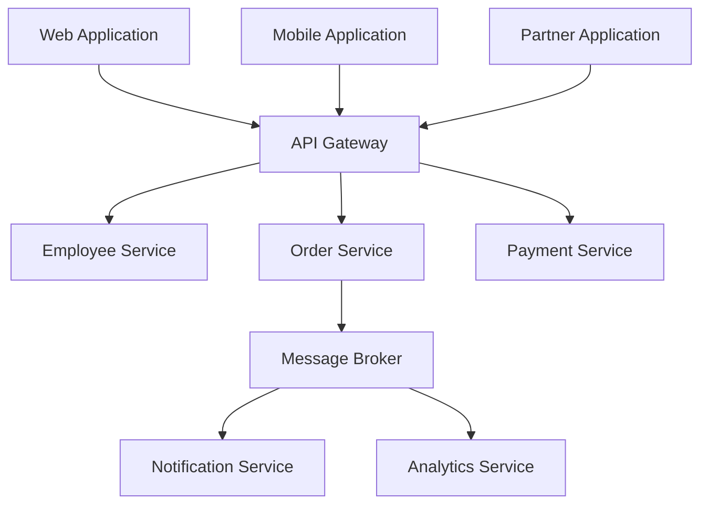

### Real-World Example

An e-commerce company in Bengaluru might use:

- REST for mobile and web applications.
- GraphQL for a product discovery interface.
- gRPC for internal communication between microservices.
- Events for order confirmation and notification processing.
- WebSockets for live delivery tracking.

The technologies complement one another rather than competing in every situation.

---

## 1.5 API Terminology

Understanding API terminology is essential before designing or implementing APIs.

| Term | Explanation |
|---|---|
| API | Interface that enables software applications to communicate |
| Client | Application that initiates an API request |
| Server | Application that processes requests and returns responses |
| Endpoint | Address through which an API operation is accessed |
| URI | Uniform Resource Identifier used to identify a resource |
| URL | Uniform Resource Locator that identifies the location of a resource |
| HTTP | Protocol commonly used for web API communication |
| Request | Message sent by a client to a server |
| Response | Message returned by a server |
| Header | Metadata associated with an HTTP request or response |
| Body | Main content carried in a request or response |
| Payload | Data transferred as part of a message |
| Resource | Business entity exposed through an API |
| Representation | Format in which resource information is communicated |
| Contract | Agreement describing API behavior and structure |
| Authentication | Process of verifying identity |
| Authorization | Process of checking permissions |
| Versioning | Managing API changes over time |
| Middleware | Component that processes requests and responses within an application pipeline |
| API Gateway | Entry point that manages API traffic |
| Rate Limiting | Restricting the number of requests over a period |

### Example: Understanding an API Request

```http
GET /api/employees/101 HTTP/1.1
Host: api.company.in
Accept: application/json
Authorization: Bearer eyJhbGciOi...
```

Breakdown:

- `GET`: HTTP method.
- `/api/employees/101`: Resource endpoint.
- `HTTP/1.1`: HTTP protocol version.
- `Host`: Server information.
- `Accept`: Expected response representation.
- `Authorization`: Authentication credentials.

### Real-World Example

When a mobile banking application requests an account balance, it acts as the client. The banking backend acts as the server, the account balance is the resource representation, and the endpoint identifies the requested account information.

---

## 1.6 Advantages and Disadvantages of APIs

APIs provide several benefits, but they also introduce engineering responsibilities.

### Advantages

**1. Reusability**

An API allows multiple applications to reuse the same business functionality. For example, a customer information API can be consumed by a web portal, mobile application, and internal administrative application.

**2. Separation of Concerns**

The frontend and backend can be developed independently as long as both follow the API contract. Changes in the backend database do not necessarily require frontend modifications.

**3. Integration**

APIs allow organizations to integrate different platforms and technologies. A .NET application can communicate with a Java application or a Python-based analytics service without sharing the same implementation language.

**4. Scalability**

APIs make it possible to distribute application functionality across independently scalable services. For example, an organization can scale its payment service independently of its employee management service.

**5. Platform Independence**

Applications written in different programming languages can communicate through common protocols and data formats. This is especially useful in heterogeneous enterprise environments.

**6. Automation**

APIs enable automated business processes, including payment processing, report generation, notifications, and data synchronization.

### Disadvantages and Challenges

**1. Security Risks**

APIs expose application functionality through network interfaces. Poor authentication, authorization, input validation, or access control can expose sensitive business data.

**2. Network Dependency**

API communication depends on network availability. Slow connections, timeouts, and service failures can affect application behavior.

**3. Version Management**

Changes to API contracts can affect existing consumers. Organizations must carefully manage breaking changes and compatibility.

**4. Performance Overhead**

Multiple API calls may introduce additional network latency. Poorly designed endpoints can increase server load and database operations.

**5. Monitoring Complexity**

When multiple services communicate, identifying the source of a failure can become difficult. Distributed tracing, centralized logging, and monitoring are important.

### Real-World Example

An online shopping application may depend on product, customer, inventory, payment, and delivery APIs. If the payment service becomes unavailable, the customer may not be able to complete an order even when the remaining services are operational.

This demonstrates why API reliability, security, and monitoring are important.

---

# MODULE 2: DESIGNING APIs – CONCEPTS AND CONTRACTS

## 2.1 What Is API Design?

API design is the process of defining how external applications will interact with a software system.

It determines the API's:

- Resources and endpoints.
- Operations and HTTP methods.
- Request and response structures.
- Error handling.
- Authentication and authorization requirements.
- Versioning strategy.
- Documentation and testing requirements.

API design should happen before implementation whenever possible.

**Analogy:**

Consider constructing a house.

Before construction begins, an architect prepares a blueprint showing rooms, dimensions, doors, windows, electrical connections, and plumbing.

Similarly, API design creates a blueprint describing how applications will communicate.

Writing code without a clear API design is similar to constructing a house without an architectural plan.

### Real-World Example

Before implementing an employee management API, a development team should decide:

- How employees will be identified.
- Which fields are mandatory.
- How employee creation will work.
- How duplicate employee records will be handled.
- What response should be returned when an employee is not found.

These decisions become part of the API design.

---

## 2.2 Anatomy of API Roles

An API ecosystem contains multiple participants.

Understanding their responsibilities helps establish a clean architecture.

### 2.2.1 API Consumer

An API consumer is an application or system that uses an API.

Examples include:

- Web applications.
- Mobile applications.
- Desktop applications.
- Third-party applications.
- Other backend services.

A consumer sends requests according to the API contract.

### 2.2.2 API Provider

An API provider is the system that exposes an API.

It defines the available endpoints, validates incoming requests, executes business logic, and returns responses.

### 2.2.3 API Developer

An API developer designs and implements the API.

The developer is responsible for resource modeling, request validation, business logic integration, error handling, and implementation of the API contract.

### 2.2.4 API Owner

The API owner is responsible for the API's lifecycle and business purpose.

This role may include deciding which capabilities should be exposed, managing version changes, defining access policies, and ensuring the API meets business requirements.

### 2.2.5 API Gateway

An API gateway acts as a centralized entry point for API traffic.

It can handle:

- Request routing.
- Authentication integration.
- Rate limiting.
- Logging.
- Traffic management.
- Request and response transformation.

It should not automatically become a repository for all business logic.

### 2.2.6 API Administrator

An API administrator manages API infrastructure, deployment, policies, monitoring, and operational configurations.

In large organizations, API administration may involve API management platforms.

### API Communication Architecture

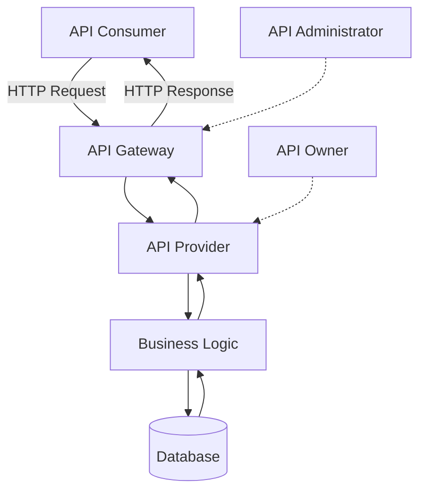

### Role Comparison

| Role | Responsibility |
|---|---|
| Consumer | Uses the API |
| Provider | Exposes the API |
| Developer | Designs and implements the API |
| Owner | Defines business purpose and lifecycle |
| Gateway | Manages API traffic |
| Administrator | Manages operational configuration |

### Real-World Example

A Bengaluru-based e-commerce organization exposes a product API.

Its Android application consumes the API, the .NET backend provides it, the API gateway manages requests, and the product team owns its business requirements.

---

## 2.3 Anatomy of an API Request and Response

Every HTTP API interaction involves a request and a response.

### 2.3.1 Anatomy of an HTTP Request

An HTTP request typically contains:

1. Request method.
2. Request target or path.
3. HTTP version.
4. Headers.
5. Optional body.

Example:

```http
POST /api/employees HTTP/1.1
Host: api.company.in
Content-Type: application/json
Accept: application/json
Authorization: Bearer <access-token>

{
  "employeeName": "Ananya Rao",
  "city": "Mysuru",
  "department": "Engineering"
}
```

Explanation:

| Component | Purpose |
|---|---|
| POST | Indicates the requested operation |
| /api/employees | Identifies the resource collection |
| Content-Type | Indicates the request body format |
| Accept | Indicates acceptable response formats |
| Authorization | Carries credentials |
| Request body | Contains employee information |

### 2.3.2 Anatomy of an HTTP Response

An HTTP response generally contains:

1. HTTP version.
2. Status code.
3. Status description.
4. Response headers.
5. Optional response body.

Example:

```http
HTTP/1.1 201 Created
Content-Type: application/json
Location: /api/employees/102

{
  "employeeId": 102,
  "employeeName": "Ananya Rao",
  "city": "Mysuru",
  "department": "Engineering"
}
```

The status code indicates that a new resource was successfully created.

The `Location` header identifies the newly created resource.

### 2.3.3 Request-Response Lifecycle

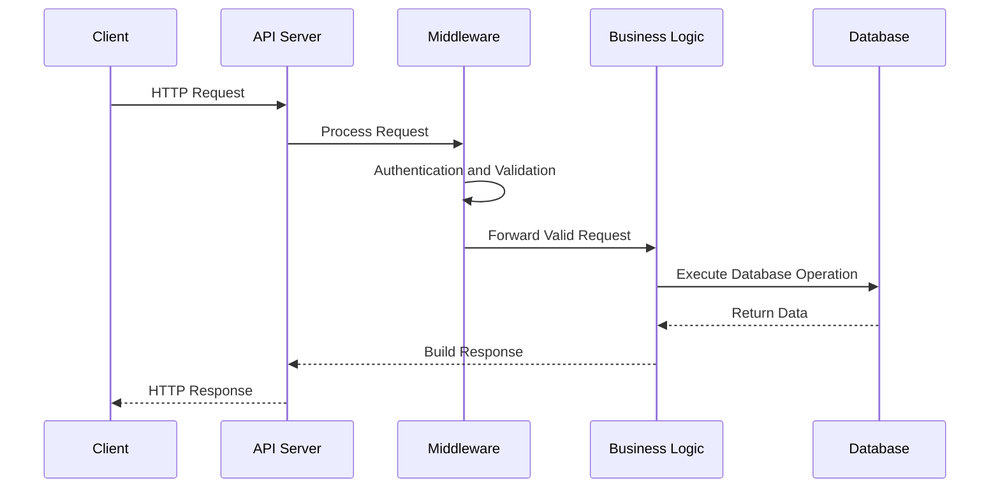

### Real-World Example

When Ananya Rao submits an employee registration form, the browser sends a POST request. The API validates her details, checks for duplicate records, inserts the employee into the database, and returns HTTP 201 Created.

---

## 2.4 API Errors and Error Handling

Errors are an unavoidable part of software systems.

A well-designed API should communicate errors consistently and meaningfully.

An API should not simply return an unexplained failure message.

### 2.4.1 Categories of API Errors

**1. Client Errors**

These occur when the request contains invalid information or the client does not have permission to perform an operation.

Examples:

- Invalid employee ID.
- Missing mandatory fields.
- Invalid authentication token.
- Accessing an unauthorized resource.

**2. Server Errors**

These occur when the server cannot successfully process an otherwise valid request.

Examples:

- Database unavailable.
- Internal application exception.
- External payment service failure.
- Unexpected processing error.

**3. Network Errors**

These occur when communication between the client and server fails.

Examples:

- Connection timeout.
- DNS resolution failure.
- Network disconnection.
- TLS handshake failure.

### 2.4.2 Standard HTTP Error Status Codes

| Status | Meaning | Example |
|---|---|---|
| 400 | Bad Request | Invalid request data |
| 401 | Unauthorized | Missing or invalid credentials |
| 403 | Forbidden | Authenticated user lacks permission |
| 404 | Not Found | Employee does not exist |
| 405 | Method Not Allowed | POST is not supported on an endpoint |
| 409 | Conflict | Duplicate employee number |
| 415 | Unsupported Media Type | Unsupported request format |
| 422 | Unprocessable Content | Semantically invalid request |
| 429 | Too Many Requests | Rate limit exceeded |
| 500 | Internal Server Error | Unexpected application exception |
| 502 | Bad Gateway | Invalid response from an upstream server |
| 503 | Service Unavailable | Service temporarily unavailable |
| 504 | Gateway Timeout | Upstream service timeout |

### 2.4.3 Standardized Error Response

A consistent error structure makes client-side error handling easier.

Consider an invalid employee registration request.

```json
{
  "type": "https://api.company.in/errors/validation",
  "title": "Validation Failed",
  "status": 400,
  "detail": "One or more fields contain invalid values.",
  "errors": {
    "employeeName": [
      "Employee name is required."
    ],
    "email": [
      "A valid email address is required."
    ]
  },
  "traceId": "00-abc123-example"
}
```

This structure follows the general principles of Problem Details for HTTP APIs, standardized in RFC 9457.

### 2.4.4 Best Practices for Error Handling

- Return appropriate HTTP status codes instead of returning HTTP 200 for every outcome. This allows consumers, gateways, and monitoring systems to identify failures correctly.
- Avoid exposing database connection strings, stack traces, passwords, internal server paths, or sensitive implementation details. Such information can help attackers understand the internal architecture.
- Provide meaningful error descriptions that help consumers correct their requests. The message should explain what went wrong without exposing sensitive internal information.
- Include a correlation or trace identifier. This helps support teams locate the corresponding server-side log entries.
- Use a consistent error response structure. Consumers can implement reusable error-handling logic rather than writing separate logic for every endpoint.

### Real-World Example

Suppose Rahul Sharma tries to register an employee with an email address that already exists.

The API should return:

```http
HTTP/1.1 409 Conflict
Content-Type: application/problem+json
```

```json
{
  "title": "Employee Already Exists",
  "status": 409,
  "detail": "An employee with this email address already exists."
}
```

The client can display a meaningful message instead of showing a generic server error.

---

## 2.5 API Contracts

An API contract defines the agreement between an API provider and its consumers.

It describes how an API should behave, including the expected request structure, response structure, operations, and error conditions.

**Analogy:**

A contract between a customer and a bank defines what services the bank provides and what conditions apply.

An API contract serves a similar purpose between two software systems.

### 2.5.1 What Does an API Contract Define?

A contract generally defines:

- Available endpoints and HTTP methods.
- Request parameters.
- Request headers.
- Request body schemas.
- Response schemas.
- HTTP status codes.
- Authentication requirements.
- Validation rules.
- Error structures.

### Example API Contract

Consider an endpoint for creating employees.

**Endpoint:**

```http
POST /api/employees
```

**Request:**

```json
{
  "employeeName": "Kavya Reddy",
  "email": "kavya@example.in",
  "city": "Hyderabad",
  "department": "Finance"
}
```

**Successful response:**

```http
201 Created
```

```json
{
  "employeeId": 103,
  "employeeName": "Kavya Reddy",
  "email": "kavya@example.in",
  "city": "Hyderabad",
  "department": "Finance"
}
```

**Possible errors:**

| Status | Condition |
|---|---|
| 400 | Invalid employee data |
| 401 | Authentication missing |
| 403 | Insufficient permissions |
| 409 | Duplicate employee |
| 500 | Unexpected server failure |

### 2.5.2 Why Are Contracts Important?

Contracts enable frontend and backend teams to work independently.

For example, the frontend team can build the employee registration screen using the agreed request and response structure even before the backend implementation is complete.

Similarly, the backend team can implement the API without needing to know the frontend's internal framework.

### 2.5.3 Contract-First Development

In contract-first development, the API contract is created and reviewed before implementation.

The contract becomes the reference for developers, testers, and consumers.

### Real-World Example

A company has separate teams working on an Angular frontend and a .NET backend.

Both teams agree on the employee API contract first. The frontend team uses mock responses, while the backend team implements the actual database integration.

This reduces dependency between teams.

---

## 2.6 Detail Exposure and Information Hiding

API design should expose only the information required by consumers.

An API should not reveal unnecessary internal database structures or implementation details.

This principle is closely related to encapsulation and abstraction in software engineering.

### Example: Database Entity vs API Response

Suppose the database contains an employee table:

| Column | Example |
|---|---|
| EmployeeId | 101 |
| EmployeeName | Rahul Sharma |
| Email | rahul@example.in |
| PasswordHash | Internal hash |
| Salary | 85000 |
| InternalAuditFlag | 1 |
| CreatedBy | Admin123 |

A public employee API should not automatically expose every column.

A response might contain:

```json
{
  "employeeId": 101,
  "employeeName": "Rahul Sharma",
  "email": "rahul@example.in",
  "department": "IT"
}
```

The password hash and internal audit information should never be exposed.

Salary information should only be provided to consumers with the appropriate authorization.

### Why Is Detail Exposure Important?

**Security:** Unnecessary fields may expose sensitive business information.

**Maintainability:** Internal database changes should not automatically break API consumers.

**Abstraction:** Consumers should work with business-level concepts rather than internal database implementation.

**Flexibility:** The backend can change its internal architecture without requiring every consumer to change.

### DTO – Data Transfer Object

A DTO is an object designed to carry data between application layers or across application boundaries.

Instead of directly exposing database entities, an API can use dedicated DTOs.

Example in C#:

```csharp
public class EmployeeResponseDto
{
    public int EmployeeId { get; set; }

    public string EmployeeName { get; set; }

    public string Email { get; set; }

    public string City { get; set; }
}
```

The application maps database entities to response DTOs.

### Real-World Example

An employee database may contain salary, bank account information, and personal identification details. The public employee directory API should return only information required to display the employee's professional profile.

---

## 2.7 API Standards

Standards help different applications communicate consistently.

Without standards, each team might implement its own conventions for URLs, data formats, authentication, and error handling.

Important API standards and specifications include:

| Standard | Purpose |
|---|---|
| HTTP | Defines request-response communication |
| HTTPS | Provides HTTP communication over TLS |
| JSON | Standardized data interchange format |
| REST | Architectural style for networked applications |
| OpenAPI | Describes HTTP APIs |
| OAuth 2.0 | Authorization framework |
| JWT | Compact token format |
| RFC 9457 | Problem Details for HTTP APIs |
| RFC 3339 | Date and time representation |
| RFC 3986 | URI syntax |

### Real-World Example

A banking application developed in Java and a payment gateway developed in .NET can communicate using HTTPS, JSON, standardized HTTP status codes, and OAuth-based access tokens.

Both applications can interoperate without sharing the same programming language or database.

---

## 2.8 Design First vs Code First

There are two common approaches to API development.

### 2.8.1 Design First

Design-first development starts by defining the API contract.

The development team decides:

- What endpoints are required.
- What HTTP methods will be used.
- What request and response structures are expected.
- What validation rules apply.
- What errors can occur.

After the design is reviewed, developers implement the API.

**Flow:**

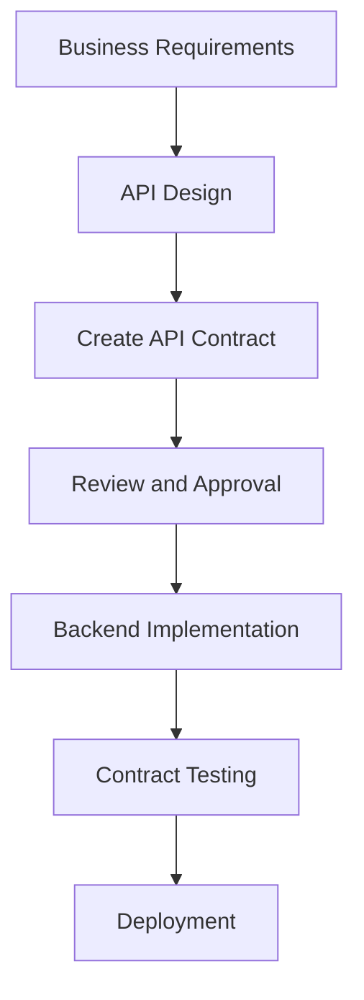

**Advantages:**

- Frontend and backend teams can work in parallel.
- API behavior is agreed upon before implementation.
- Documentation can be generated from the contract.
- Design inconsistencies can be identified early.

**Disadvantages:**

- Initial design requires additional effort.
- Poorly understood requirements can lead to repeated contract changes.
- The contract must be maintained as implementation evolves.

### 2.8.2 Code First

Code-first development begins with implementation.

Developers create controllers, methods, models, and business logic.

API documentation or specifications are then generated from the code using tools such as Swagger/OpenAPI generators.

**Flow:**

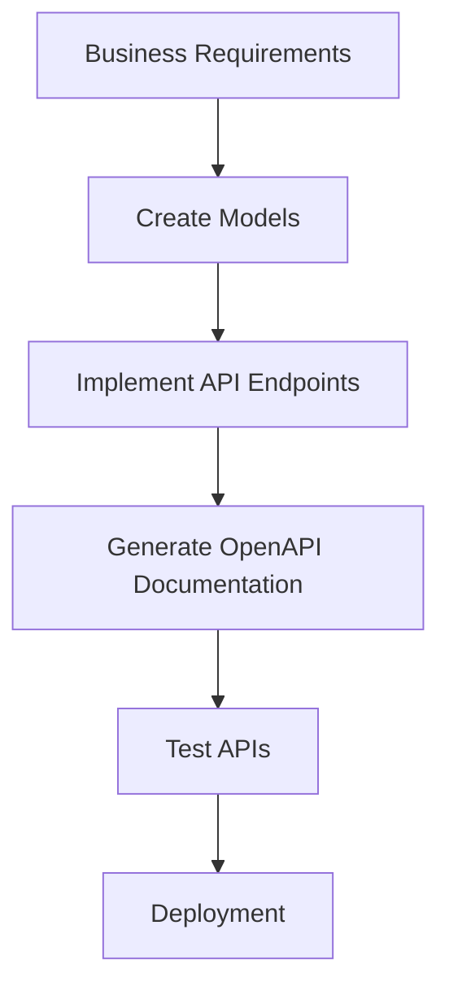

**Advantages:**

- Developers can start implementation quickly.
- Useful for small applications and prototypes.
- API documentation can be generated automatically.

**Disadvantages:**

- Design decisions may be driven by implementation convenience.
- Frontend teams may need to wait for backend availability.
- Documentation can become outdated if it is not generated or validated consistently.

### Comparison

| Criteria | Design First | Code First |
|---|---|---|
| Starting point | API contract | Source code |
| Documentation | Created before implementation | Commonly generated afterward |
| Parallel development | Easier | May require coordination |
| Initial effort | Higher | Often lower |
| Best suited for | Large systems and multiple consumers | Prototypes and smaller applications |
| Contract validation | Central to workflow | Must be added to development process |

### 2.8.3 Which Approach Should Be Used?

Design-first is particularly useful when multiple teams or external consumers depend on the same API.

Code-first can be suitable for smaller internal applications where requirements are simple and the development team controls all consumers.

Many mature organizations use a hybrid approach: they define contracts first, implement APIs, and continuously generate or validate documentation against the implementation.

### Real-World Example

A company developing a banking API for multiple mobile applications and external partners should strongly consider design-first development.

A small internal application for managing office assets might use code-first development.

---

## 2.9 API Testing

API testing verifies that an API behaves according to its contract and business requirements.

It checks more than whether an endpoint returns a successful response.

### Types of API Testing

**1. Functional Testing**

Verifies whether API operations perform the expected business functions. For example, creating an employee should create a valid employee record.

**2. Integration Testing**

Verifies communication between the API and external dependencies such as databases, payment gateways, and other services.

**3. Contract Testing**

Checks whether the API implementation follows its published contract. It is especially useful when multiple applications consume the same API.

**4. Security Testing**

Checks authentication, authorization, access control, input validation, and protection against common API vulnerabilities.

**5. Performance Testing**

Evaluates response time, throughput, concurrency, and resource utilization under different workloads.

**6. Negative Testing**

Checks how the API handles invalid input, missing parameters, unauthorized requests, and unsupported operations.

### API Testing Tools

| Tool | Purpose |
|---|---|
| Postman | Manual API testing and automated collections |
| Swagger UI | Interactive API exploration |
| curl | Command-line HTTP requests |
| REST Assured | Java API automation |
| NUnit / xUnit | .NET API testing |
| JMeter | Performance testing |
| k6 | Load and performance testing |
| Pact | Consumer-driven contract testing |

### Example: Testing an Employee API with curl

```bash
curl -X GET \
  "https://localhost:5001/api/employees/101" \
  -H "Accept: application/json"
```

Testing employee creation:

```bash
curl -X POST \
  "https://localhost:5001/api/employees" \
  -H "Content-Type: application/json" \
  -d '{
    "employeeName": "Arjun Kumar",
    "city": "Chennai",
    "department": "IT"
  }'
```

### Example Test Cases

| Test Case | Input | Expected Result |
|---|---|---|
| Retrieve existing employee | ID 101 | 200 OK |
| Retrieve missing employee | ID 999 | 404 Not Found |
| Create valid employee | Valid JSON | 201 Created |
| Create invalid employee | Missing name | 400 Bad Request |
| Delete existing employee | ID 101 | Successful deletion |
| Access protected API | No token | 401 Unauthorized |

### Real-World Example

Before releasing an employee management API, the QA team tests employee creation, retrieval, update, and deletion. It also verifies that employees cannot access administrative endpoints without the required permissions.

---

# MODULE 3: API DESIGN, SECURITY AND STANDARDS

## 3.1 Designing APIs for Existing Systems

Organizations frequently need to expose API functionality from systems that were developed many years ago.

These systems are commonly called legacy systems.

A legacy system may use:

- Mainframe applications.
- Traditional relational databases.
- Stored procedures.
- SOAP web services.
- Desktop applications.
- Proprietary communication protocols.
- Older programming languages.

Replacing such systems immediately can be expensive and risky.

A better approach is often to introduce an API layer around the existing application.

### 3.1.1 Why Do We Need APIs for Existing Systems?

Consider an organization that maintains an employee management application developed 15 years ago.

The system provides employee information through:

- SQL Server stored procedures.
- Desktop application interfaces.
- Internal business components.

Now the organization wants to introduce a modern mobile application.

The mobile application should not directly access the old database.

Instead, the organization can introduce an API layer that communicates with the existing system.

### Architecture

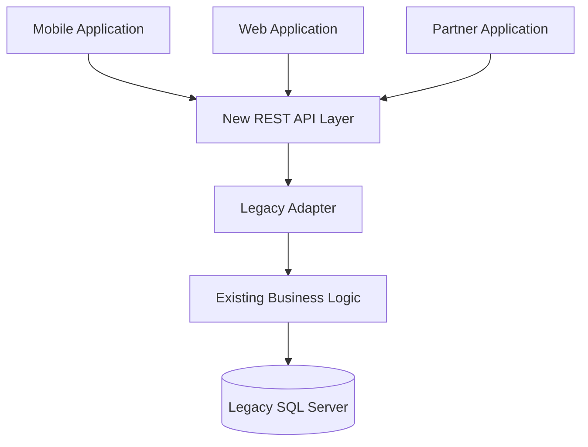

The REST API acts as an abstraction layer between modern consumers and the legacy application.

### 3.1.2 Conversion of Concepts

The most important challenge when exposing an API for an existing system is converting legacy concepts into modern API concepts.

For example, a legacy system might expose operations such as:

```text
GET_EMP_DETAILS
INSERT_EMP_RECORD
UPDATE_EMP_INFO
DELETE_EMP_RECORD
```

These operations may be based on stored procedures or remote functions.

A REST API should model business resources and their operations.

Possible REST endpoints:

```http
GET    /api/employees
GET    /api/employees/101
POST   /api/employees
PUT    /api/employees/101
PATCH  /api/employees/101
DELETE /api/employees/101
```

### Legacy Concept vs REST Concept

| Legacy Concept | REST API Equivalent |
|---|---|
| Stored procedure | API operation |
| Employee table | Employee resource |
| Employee primary key | Resource identifier |
| Stored procedure parameters | Request parameters or request body |
| Stored procedure result set | JSON response |
| Database error | Appropriate HTTP error response |
| Database transaction | Business operation with transaction management |

### 3.1.3 Anti-Corruption Layer

An anti-corruption layer is a software design pattern used to prevent one system's internal model from leaking into another system.

For example, a legacy payroll system may use an internal field called `EMP_CD`, whereas the modern API exposes `employeeId`.

The adapter translates between these representations.

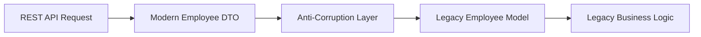

This approach helps protect the new architecture from legacy implementation details.

### 3.1.4 Strangler Pattern

The Strangler Fig Pattern is a modernization approach in which new functionality gradually replaces old functionality.

Instead of rewriting the entire system at once, the organization introduces new services incrementally.

Example:

- Employee retrieval is moved to a new REST service.
- Employee registration is migrated later.
- Payroll functionality remains in the legacy system until it is ready for modernization.

### Real-World Example

A Bengaluru-based manufacturing company has a legacy employee application built using .NET Framework and SQL Server.

The company develops a new .NET 8 REST API that communicates with the existing database through a controlled repository and adapter layer. The mobile application consumes the new API without directly depending on the legacy desktop application.

---

## 3.2 API Security

API security protects the information, operations, and infrastructure exposed through APIs.

APIs can expose sensitive information such as customer records, financial transactions, employee details, and payment operations.

Security must be considered during API design rather than added only after development.

### 3.2.1 Authentication vs Authorization

These two terms are often confused.

**Authentication** answers:

"Who are you?"

It verifies the identity of a user or application.

**Authorization** answers:

"What are you allowed to do?"

It determines whether an authenticated identity has permission to perform a particular operation.

**Analogy:**

Imagine entering an office building.

- Your employee identity card proves who you are. This is authentication.
- Your access permissions determine whether you can enter the server room. This is authorization.

### Comparison

| Authentication | Authorization |
|---|---|
| Verifies identity | Verifies permissions |
| Happens before protected access is granted | Determines permitted operations |
| Uses credentials or identity tokens | Uses roles, claims, scopes, or policies |
| Example: Login | Example: Access payroll data |

### 3.2.2 Common API Security Mechanisms

**1. HTTPS**

HTTPS protects communication between client and server using TLS.

It provides encryption and server authentication, helping prevent attackers from reading or modifying traffic in transit.

**2. API Keys**

An API key is a credential used to identify an application or API consumer.

API keys are useful for certain application integrations, but they should not be treated as a replacement for user authentication and fine-grained authorization.

**3. Basic Authentication**

Basic authentication transmits a username and password encoded using Base64.

Base64 is not encryption. Basic authentication should only be used over HTTPS and is generally unsuitable for modern user authentication without additional protections.

**4. Bearer Tokens**

A bearer token is a credential that grants access to whoever possesses it.

Clients generally send bearer tokens in the HTTP Authorization header.

```http
Authorization: Bearer <access-token>
```

Anyone who obtains a valid bearer token may be able to use it, so tokens must be protected.

**5. OAuth 2.0**

OAuth 2.0 is an authorization framework that allows applications to obtain limited access to protected resources.

**6. JWT**

JWT is a compact token format that can carry claims about an identity or authorization context.

It is frequently used in token-based authentication and authorization architectures.

### 3.2.3 Common API Security Threats

| Threat | Explanation | Mitigation |
|---|---|---|
| Broken Object Level Authorization | Users access another user's records | Validate resource ownership and permissions |
| Broken Authentication | Weak or incorrectly implemented authentication | Use established identity protocols |
| Broken Function Level Authorization | Users invoke unauthorized operations | Enforce role and policy checks |
| Injection | Malicious input affects queries or commands | Validate input and use parameterized queries |
| Sensitive Data Exposure | APIs reveal confidential information | Minimize data exposure and encrypt sensitive information |
| Excessive Resource Consumption | Attackers overload the API | Apply rate limits and resource controls |
| Security Misconfiguration | Incorrect security settings expose the API | Secure configuration and regular reviews |

The OWASP API Security Top 10 is an important reference for understanding API-specific vulnerabilities.

### Real-World Example

A banking API exposes account information through:

```http
GET /api/accounts/1001
```

The API must verify that the authenticated customer owns account 1001 or has another explicitly authorized relationship with that account.

Checking only whether the user is logged in is insufficient.

---

## 3.3 Authorization and OAuth 2.0

OAuth 2.0 is an authorization framework defined by RFC 6749.

It enables an application to obtain access to protected resources without directly receiving or storing the resource owner's password.

### 3.3.1 Important OAuth Terminology

| Term | Meaning |
|---|---|
| Resource Owner | Entity that owns the protected information |
| Client | Application requesting access |
| Authorization Server | Server that issues access tokens |
| Resource Server | Server that hosts protected resources |
| Access Token | Credential used to access protected resources |
| Refresh Token | Credential used to obtain new access tokens |
| Scope | Defines the access requested or granted |

### 3.3.2 OAuth 2.0 Authorization Code Flow with PKCE

This is the recommended approach for many user-facing applications, including mobile and browser-based applications.

PKCE stands for Proof Key for Code Exchange.

It adds protection against authorization code interception.

**Flow:**

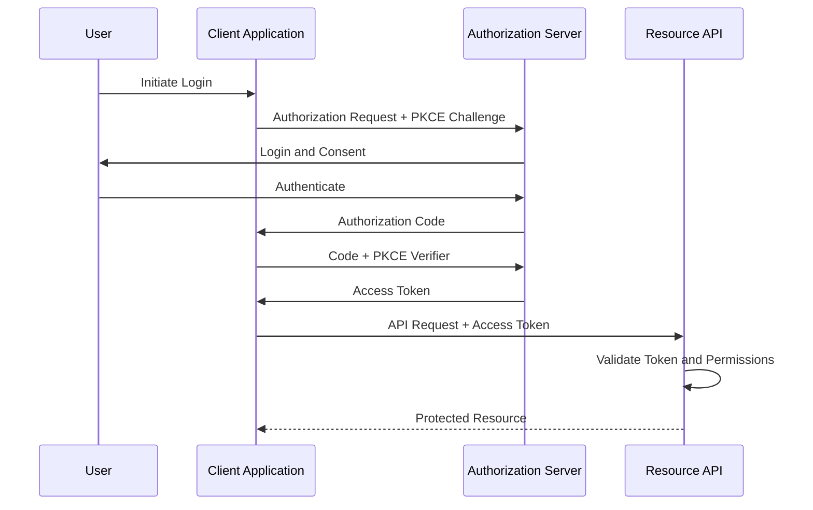

### 3.3.3 OAuth 2.0 Grant Types

| Grant Type | Purpose | Current Guidance |
|---|---|---|
| Authorization Code | User authorization through an authorization server | Recommended, generally with PKCE |
| Client Credentials | Machine-to-machine access | Suitable for confidential clients |
| Device Authorization | Devices with limited input capability | Suitable for device-based scenarios |
| Refresh Token | Obtain new access tokens | Used as part of supported authorization flows |
| Implicit | Legacy browser-based token flow | Avoid in modern implementations |
| Resource Owner Password Credentials | Direct username/password grant | Deprecated and should not be used |

### 3.3.4 Scope-Based Authorization

OAuth scopes define the permissions requested by a client.

Example:

```text
employee.read
employee.write
payroll.read
payroll.approve
```

An application granted `employee.read` should not automatically be permitted to modify employee records.

### 3.3.5 OAuth 2.0 vs OpenID Connect

OAuth 2.0 is primarily an authorization framework.

OpenID Connect (OIDC) adds an identity layer on top of OAuth 2.0 and enables clients to authenticate users.

OIDC introduces an ID token, which communicates information about the authenticated user.

| OAuth 2.0 | OpenID Connect |
|---|---|
| Authorization | Authentication and identity |
| Access token | ID token and access token |
| Grants access to resources | Communicates user identity |
| Defines scopes and authorization flows | Defines identity claims and authentication behavior |

### Real-World Example

An employee logs in to an organization's application using Microsoft Entra ID.

The application receives tokens through an OIDC authorization flow and uses an access token to call the protected employee API.

The API validates the token and checks whether the employee has permission to retrieve payroll information.

---

## 3.4 API Design Basics

A well-designed REST API should use consistent naming conventions, appropriate HTTP methods, correct status codes, and meaningful resource structures.

### 3.4.1 Resource-Oriented Design

REST APIs should generally expose nouns representing business resources rather than verbs representing operations.

**Preferred:**

```http
GET /api/employees
GET /api/employees/101
POST /api/employees
DELETE /api/employees/101
```

**Avoid where possible:**

```http
GET /api/getEmployees
POST /api/createEmployee
GET /api/deleteEmployee/101
```

The HTTP method already describes the intended operation.

### 3.4.2 Collection and Individual Resources

A collection represents multiple resources.

```http
GET /api/employees
```

An individual resource represents one specific entity.

```http
GET /api/employees/101
```

### 3.4.3 Nested Resources

Nested endpoints can represent relationships between resources.

Example:

```http
GET /api/employees/101/projects
```

This retrieves projects associated with employee 101.

However, deeply nested URL structures should be avoided because they become difficult to maintain.

### 3.4.4 Filtering, Sorting and Pagination

Large collections should support controlled retrieval.

Filtering:

```http
GET /api/employees?city=Bengaluru
```

Sorting:

```http
GET /api/employees?sortBy=employeeName&order=asc
```

Pagination:

```http
GET /api/employees?page=1&pageSize=15
```

A response could look like:

```json
{
  "items": [
    {
      "employeeId": 101,
      "employeeName": "Rahul Sharma",
      "city": "Bengaluru"
    }
  ],
  "page": 1,
  "pageSize": 15,
  "totalRecords": 125,
  "totalPages": 9
}
```

For large datasets, cursor-based pagination can be more efficient and stable than offset-based pagination.

### Real-World Example

An HR application contains 10,000 employee records. Instead of sending all records to the browser, the frontend requests 15 records at a time and retrieves additional pages when required.

---

## 3.5 HTTP Methods

HTTP methods describe the intended action on a resource.

The most important methods used in REST APIs are GET, POST, PUT, PATCH, and DELETE.

### 3.5.1 GET

GET retrieves a resource or collection of resources.

Example:

```http
GET /api/employees/101
```

Response:

```json
{
  "employeeId": 101,
  "employeeName": "Rahul Sharma",
  "city": "Bengaluru"
}
```

GET is considered a safe method because it should not change the state of the requested resource.

It is also idempotent.

### 3.5.2 POST

POST submits information to a resource, commonly to create a new resource or initiate a processing operation.

Example:

```http
POST /api/employees
Content-Type: application/json
```

```json
{
  "employeeName": "Sneha Rao",
  "city": "Mysuru"
}
```

POST is generally not idempotent.

Submitting the same creation request multiple times may create multiple employee records unless the application implements an idempotency mechanism.

### 3.5.3 PUT

PUT creates or replaces the state of a resource at the target URI, depending on the API's design.

Example:

```http
PUT /api/employees/101
```

```json
{
  "employeeName": "Rahul Sharma",
  "city": "Hubballi",
  "department": "Engineering"
}
```

PUT is idempotent.

Repeating the same request should result in the same resource state.

### 3.5.4 PATCH

PATCH applies a partial modification to a resource.

Example:

```http
PATCH /api/employees/101
```

```json
{
  "city": "Mangaluru"
}
```

Only the city is updated.

PATCH is not automatically idempotent. Its idempotency depends on the patch operation and API implementation.

### 3.5.5 DELETE

DELETE requests removal of a resource.

Example:

```http
DELETE /api/employees/101
```

DELETE is idempotent in HTTP semantics: repeating the same deletion should not produce an additional state change, even though subsequent responses may differ.

### HTTP Method Comparison

| Method | Purpose | Safe | Idempotent |
|---|---|---|---|
| GET | Retrieve resource | Yes | Yes |
| POST | Create or process | No | No, generally |
| PUT | Create or replace resource | No | Yes |
| PATCH | Partially modify resource | No | Not necessarily |
| DELETE | Remove resource | No | Yes |

**Important concepts:**

- Safe means the client is not requesting a state-changing operation.
- Idempotent means repeating the same request has the same intended effect on server state as performing it once.

### Real-World Example

An HR application uses GET to retrieve Rahul's employee record, POST to register a new employee, PUT to replace the employee profile, PATCH to update only the employee's city, and DELETE to remove the employee record.

---

## 3.6 HTTP Status Codes

HTTP status codes communicate the result of an HTTP request.

They are grouped into five categories.

### 3.6.1 1xx – Informational

These codes indicate that the request has been received and processing is continuing.

Example: `100 Continue`.

### 3.6.2 2xx – Success

These codes indicate successful processing.

| Code | Meaning | Common API Scenario |
|---|---|---|
| 200 | OK | Successful GET or update |
| 201 | Created | Successful resource creation |
| 202 | Accepted | Request accepted for asynchronous processing |
| 204 | No Content | Successful operation without response body |

### 3.6.3 3xx – Redirection

These codes indicate that additional action is required or that a resource has moved.

| Code | Meaning |
|---|---|
| 301 | Moved Permanently |
| 302 | Found |
| 304 | Not Modified |
| 307 | Temporary Redirect |
| 308 | Permanent Redirect |

### 3.6.4 4xx – Client Errors

These codes indicate problems with the request or client permissions.

| Code | Meaning |
|---|---|
| 400 | Bad Request |
| 401 | Unauthorized |
| 403 | Forbidden |
| 404 | Not Found |
| 405 | Method Not Allowed |
| 409 | Conflict |
| 415 | Unsupported Media Type |
| 422 | Unprocessable Content |
| 429 | Too Many Requests |

### 3.6.5 5xx – Server Errors

These codes indicate server-side processing failures.

| Code | Meaning |
|---|---|
| 500 | Internal Server Error |
| 501 | Not Implemented |
| 502 | Bad Gateway |
| 503 | Service Unavailable |
| 504 | Gateway Timeout |

### Important Interview Question: Difference Between 401 and 403

**401 Unauthorized:**

The request does not contain valid authentication credentials.

Example: A client calls a protected endpoint without a valid access token.

**403 Forbidden:**

The client is authenticated but does not have permission to perform the requested operation.

Example: An employee attempts to access an administrative payroll endpoint without the required role.

### Real-World Example

Rahul accesses an employee portal without logging in. The API returns 401.

After logging in, Rahul attempts to access the HR administrator's endpoint. The API returns 403 if he does not have the required permissions.

---

## 3.7 API Versioning

API versioning helps maintain compatibility when the API contract changes.

Suppose an existing API returns:

```json
{
  "employeeName": "Rahul Sharma"
}
```

A new version introduces a different response structure:

```json
{
  "firstName": "Rahul",
  "lastName": "Sharma"
}
```

Existing consumers may break if the response changes unexpectedly.

Versioning allows organizations to introduce changes without immediately breaking existing applications.

### Common Versioning Approaches

**1. URI Versioning**

```http
GET /api/v1/employees
GET /api/v2/employees
```

This is simple and widely used.

**2. Query Parameter Versioning**

```http
GET /api/employees?version=2
```

The API version is passed as a query parameter.

**3. Header Versioning**

```http
GET /api/employees
Accept: application/vnd.company.employee-v2+json
```

The requested version is indicated through HTTP headers.

### Comparison

| Approach | Example | Advantage |
|---|---|---|
| URI | /api/v1/employees | Easy to understand |
| Query | ?version=2 | Keeps URL structure stable |
| Header | Accept: application/vnd... | Separates version from resource URI |

### Real-World Example

A mobile application released two years ago may still depend on API v1. A newly developed application can use API v2 while the organization gradually migrates existing consumers.

---

# MODULE 4: OPENAPI AND RICHARDSON MATURITY MODEL

## 4.1 What Is OpenAPI?

OpenAPI is a standard specification used to describe HTTP APIs in a machine-readable format.

It defines:

- API endpoints.
- HTTP methods.
- Request parameters.
- Request body schemas.
- Response structures.
- Authentication schemes.
- Data models.
- API metadata.

OpenAPI helps developers, testers, documentation tools, and API consumers understand how an API works without reading its implementation source code.

### 4.1.1 What Is Swagger?

Swagger is a collection of tools associated with the OpenAPI ecosystem.

Historically, Swagger was the name of the specification. The specification was donated to the OpenAPI Initiative and became the OpenAPI Specification.

Today:

- OpenAPI refers to the specification.
- Swagger UI provides interactive API documentation.
- Swagger Editor helps author API definitions.
- Swagger Codegen and related tools support code generation.

### 4.1.2 Why Is OpenAPI Important?

OpenAPI enables consistent API documentation and supports automation.

For example, a frontend developer can inspect an API specification and understand the request and response formats without contacting the backend developer for every detail.

### Architecture

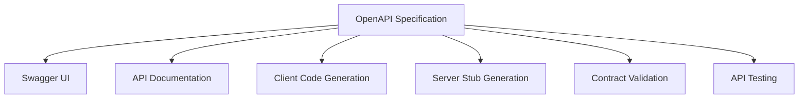

### Real-World Example

A company provides an employee API to external business partners. It publishes an OpenAPI document so partner developers can understand available endpoints, authentication requirements, and response structures.

---

## 4.2 OpenAPI 2.0 – Swagger 2.0

OpenAPI 2.0 was historically known as Swagger 2.0.

It provides a machine-readable format for describing HTTP-based APIs.

It is still encountered in older enterprise systems and legacy API documentation.

### 4.2.1 Structure of OpenAPI 2.0

An OpenAPI 2.0 document commonly contains:

| Property | Purpose |
|---|---|
| swagger | Specifies specification version |
| info | API title, description, and version |
| host | API server hostname |
| basePath | Base URL path |
| schemes | HTTP or HTTPS |
| consumes | Accepted request media types |
| produces | Response media types |
| paths | API endpoints |
| definitions | Reusable data models |
| parameters | Reusable request parameters |
| responses | Reusable responses |
| securityDefinitions | Authentication schemes |
| security | Security requirements |

### 4.2.2 OpenAPI 2.0 Example

```yaml
swagger: "2.0"

info:
  title: Employee Management API
  description: API for managing employee information
  version: "1.0.0"

host: api.company.in

basePath: /api

schemes:
  - https

consumes:
  - application/json

produces:
  - application/json

paths:
  /employees:
    get:
      summary: Get all employees
      responses:
        "200":
          description: Successful response

    post:
      summary: Create employee
      parameters:
        - in: body
          name: employee
          required: true
          schema:
            $ref: "#/definitions/Employee"
      responses:
        "201":
          description: Employee created

definitions:
  Employee:
    type: object
    properties:
      employeeId:
        type: integer
      employeeName:
        type: string
      city:
        type: string
```

### 4.2.3 Important Limitations and Differences

OpenAPI 2.0 uses:

- `definitions` for reusable schemas.
- `securityDefinitions` for security schemes.
- `consumes` and `produces` for media types.
- A specific `body` parameter mechanism for request bodies.

It also has a more limited model for describing request bodies than OpenAPI 3.x.

### Real-World Example

An enterprise application developed several years ago may contain a Swagger 2.0 specification. New developers can use the specification to understand existing endpoints before implementing changes.

---

## 4.3 Richardson Maturity Model

The Richardson Maturity Model (RMM) helps evaluate how closely an API follows REST architectural principles.

It was popularized by Leonard Richardson and is commonly described through four levels: 0, 1, 2, and 3.

The higher the maturity level, the more effectively the API uses resource-oriented concepts, HTTP methods, and hypermedia controls.

### 4.3.1 Level 0 – The Swamp of POX

POX stands for Plain Old XML.

At Level 0, an application uses HTTP mainly as a transport mechanism.

Multiple business operations may be exposed through a single endpoint, with the actual operation identified through the request body.

Example:

```http
POST /employeeService
Content-Type: application/xml
```

```xml
<GetEmployee>
    <EmployeeId>101</EmployeeId>
</GetEmployee>
```

Here, the same endpoint may support several operations depending on the message content.

**Characteristics:**

- Single endpoint or limited endpoint structure.
- HTTP methods are not used meaningfully.
- Operations are identified through message contents.
- Resource-oriented design is absent.

### 4.3.2 Level 1 – Resources

At Level 1, the API introduces individual resources.

Instead of using one endpoint for everything, different resources have different identifiers.

Example:

```http
POST /employeeService/employees/101
POST /employeeService/departments/10
```

Different URLs identify different resources.

However, HTTP methods may still be used in a non-standard or inconsistent way.

**Characteristics:**

- Resources are introduced.
- Different resource URLs are available.
- HTTP may still be treated mainly as a transport mechanism.
- Operations are not necessarily represented through standard HTTP semantics.

### 4.3.3 Level 2 – HTTP Verbs

At Level 2, the API correctly uses HTTP methods and status codes.

Example:

```http
GET /api/employees/101
POST /api/employees
PUT /api/employees/101
DELETE /api/employees/101
```

This is the level at which most commonly used REST-style APIs operate.

**Characteristics:**

- Resource-oriented URLs.
- Appropriate HTTP methods.
- Meaningful status codes.
- Correct use of request and response representations.

### 4.3.4 Level 3 – Hypermedia Controls

Level 3 introduces HATEOAS.

HATEOAS stands for Hypermedia as the Engine of Application State.

The API response contains links describing related actions or navigation options.

Example:

```json
{
  "employeeId": 101,
  "employeeName": "Rahul Sharma",
  "city": "Bengaluru",
  "_links": {
    "self": {
      "href": "/api/employees/101"
    },
    "department": {
      "href": "/api/departments/10"
    },
    "update": {
      "href": "/api/employees/101"
    }
  }
}
```

The consumer can discover related operations through the response instead of relying entirely on hardcoded navigation rules.

### Richardson Maturity Model Comparison

| Level | Name | Main Concept | HTTP Usage |
|---|---|---|---|
| 0 | POX | Single service endpoint | HTTP as transport |
| 1 | Resources | Resource identification | Resource-oriented URLs |
| 2 | HTTP Verbs | Correct HTTP semantics | Proper methods and status codes |
| 3 | Hypermedia | Discoverable actions and links | Hypermedia controls |

### Visual Representation

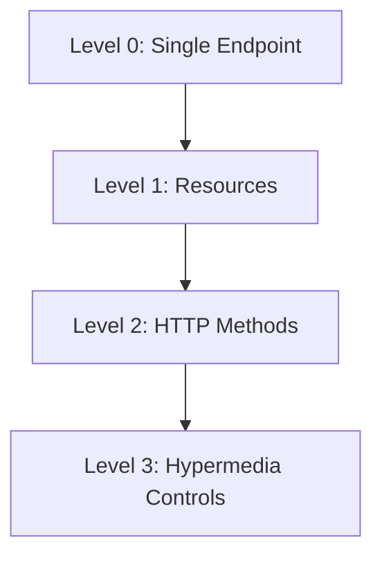

### Real-World Example

Consider an employee management API.

- Level 0: All employee operations are sent to `/employeeService`.
- Level 1: Employees have individual resource URLs.
- Level 2: GET, POST, PUT, and DELETE are used correctly.
- Level 3: Responses contain links that help clients discover related resources and available actions.

**Important:** The Richardson Maturity Model is a way to evaluate REST maturity. It is not a formal replacement for the REST architectural constraints.

---

## 4.4 OpenAPI 3.0

OpenAPI 3.0 introduced important improvements over OpenAPI 2.0.

It provides a cleaner and more expressive structure for describing modern APIs.

### 4.4.1 Major Changes from OpenAPI 2.0

| Feature | OpenAPI 2.0 | OpenAPI 3.0 |
|---|---|---|
| Specification property | swagger: "2.0" | openapi: "3.0.0" |
| Server configuration | host, basePath, schemes | servers |
| Request body | body parameter | requestBody |
| Reusable models | definitions | components/schemas |
| Security definitions | securityDefinitions | components/securitySchemes |
| Media types | consumes, produces | content |
| File upload | Special form-data handling | Improved request-body support |
| Callbacks | Not supported | Supported |

### 4.4.2 OpenAPI 3.0 Example

```yaml
openapi: 3.0.3

info:
  title: Employee Management API
  description: API for managing employee information
  version: 1.0.0

servers:
  - url: https://api.company.in/api

paths:
  /employees:
    get:
      summary: Retrieve employees
      responses:
        "200":
          description: Employees retrieved successfully
          content:
            application/json:
              schema:
                type: array
                items:
                  $ref: "#/components/schemas/Employee"

    post:
      summary: Create employee
      requestBody:
        required: true
        content:
          application/json:
            schema:
              $ref: "#/components/schemas/CreateEmployee"

      responses:
        "201":
          description: Employee created successfully

        "400":
          description: Invalid request

  /employees/{employeeId}:
    get:
      summary: Retrieve an employee
      parameters:
        - name: employeeId
          in: path
          required: true
          schema:
            type: integer

      responses:
        "200":
          description: Employee found
          content:
            application/json:
              schema:
                $ref: "#/components/schemas/Employee"

        "404":
          description: Employee not found

components:
  schemas:
    Employee:
      type: object
      properties:
        employeeId:
          type: integer
        employeeName:
          type: string
        city:
          type: string

    CreateEmployee:
      type: object
      required:
        - employeeName
        - city
      properties:
        employeeName:
          type: string
        city:
          type: string

  securitySchemes:
    BearerAuth:
      type: http
      scheme: bearer
      bearerFormat: JWT

security:
  - BearerAuth: []
```

### 4.4.3 Understanding the OpenAPI 3.0 Structure

**openapi**

Specifies which OpenAPI specification version the document uses.

**info**

Contains metadata such as API title, description, and version.

**servers**

Defines the base URLs through which the API can be accessed.

**paths**

Describes available endpoints and their supported HTTP operations.

**components**

Contains reusable schemas, parameters, responses, and security schemes.

**requestBody**

Describes the data submitted to an endpoint.

**responses**

Describes possible server responses.

**securitySchemes**

Defines the authentication mechanisms supported by the API.

### 4.4.4 Swagger UI

Swagger UI displays API documentation in an interactive browser interface.

Developers can:

- View available endpoints.
- Understand request parameters.
- Inspect JSON schemas.
- Execute API requests.
- View responses.
- Understand security requirements.

### Real-World Example

A .NET REST API exposes an OpenAPI 3.0 specification. Developers open Swagger UI, inspect the employee endpoint, provide a JWT access token, and execute a GET request directly from the browser.

---

# MODULE 5: API MECHANICS – JSON AND JWT

## 5.1 JSON – JavaScript Object Notation

JSON stands for JavaScript Object Notation.

It is a lightweight data-interchange format used to exchange information between applications.

JSON is language-independent even though its syntax is derived from JavaScript object notation.

It is widely used in REST APIs because it is relatively compact, readable, and supported by most programming languages.

### 5.1.1 Why JSON Is Used in APIs

JSON provides a standard way to represent structured data.

Applications written in different programming languages can exchange JSON without needing to understand one another's internal object structures.

For example:

- Angular can send JSON to a .NET API.
- A Java application can consume the same API.
- Python can process the response.
- A mobile application can deserialize the response.

### 5.1.2 JSON Data Types

JSON supports six basic value types.

| Data Type | Description | Example |
|---|---|---|
| String | Text value | "Rahul Sharma" |
| Number | Integer or decimal | 101, 85000.50 |
| Boolean | True or false | true |
| Object | Collection of key-value pairs | {"city":"Bengaluru"} |
| Array | Ordered collection of values | ["CSE","ECE"] |
| Null | Absence of a value | null |

### 5.1.3 JSON Object

A JSON object is represented using curly braces.

Example:

```json
{
  "employeeId": 101,
  "employeeName": "Rahul Sharma",
  "city": "Bengaluru",
  "isActive": true
}
```

Each property contains a name and a value.

Property names must be strings enclosed in double quotes.

### 5.1.4 JSON Array

An array is represented using square brackets.

Example:

```json
[
  {
    "employeeId": 101,
    "employeeName": "Rahul Sharma"
  },
  {
    "employeeId": 102,
    "employeeName": "Sneha Rao"
  },
  {
    "employeeId": 103,
    "employeeName": "Arjun Kumar"
  }
]
```

An array is useful for representing collections of employees, products, orders, or other resources.

### 5.1.5 Nested JSON Objects

JSON supports nested structures.

Example:

```json
{
  "employeeId": 101,
  "employeeName": "Rahul Sharma",
  "address": {
    "city": "Bengaluru",
    "state": "Karnataka",
    "country": "India",
    "pinCode": "560001"
  },
  "skills": [
    "C#",
    ".NET",
    "SQL Server",
    "Angular"
  ]
}
```

Here, `address` is another JSON object and `skills` is an array.

### 5.1.6 JSON vs XML

| Feature | JSON | XML |
|---|---|---|
| Structure | Key-value objects and arrays | Elements and attributes |
| Readability | Generally concise | More verbose |
| Data types | Basic native value types | Primarily text with schema-based typing |
| Parsing | Usually lightweight | Can require more processing |
| Namespaces | Not built into JSON | Supported |
| Common usage | Modern REST APIs | SOAP and document-oriented systems |

### 5.1.7 JSON Validation

Consider the following invalid JSON:

```json
{
  employeeId: 101,
  "employeeName": "Rahul Sharma",
}
```

Problems:

- `employeeId` is not enclosed in double quotes.
- A trailing comma is present.

Correct JSON:

```json
{
  "employeeId": 101,
  "employeeName": "Rahul Sharma"
}
```

### 5.1.8 JSON Serialization and Deserialization

Serialization converts an in-memory object into JSON.

Deserialization converts JSON into an in-memory object.

**Analogy:**

Imagine packing your clothes into a suitcase before travelling.

Serialization is like packing information into a standard format for transport.

Deserialization is like unpacking the information at the destination.

### C# Example

```csharp
using System.Text.Json;

public class Employee
{
    public int EmployeeId { get; set; }

    public string EmployeeName { get; set; }

    public string City { get; set; }
}

class Program
{
    static void Main()
    {
        Employee employee = new Employee
        {
            EmployeeId = 101,
            EmployeeName = "Rahul Sharma",
            City = "Bengaluru"
        };

        // Serialization
        string json = JsonSerializer.Serialize(employee);

        Console.WriteLine(json);

        // Deserialization
        Employee? result =
            JsonSerializer.Deserialize<Employee>(json);

        Console.WriteLine(result?.EmployeeName);
    }
}
```

Expected JSON:

```json
{
  "EmployeeId": 101,
  "EmployeeName": "Rahul Sharma",
  "City": "Bengaluru"
}
```

The exact output formatting depends on serializer options.

### Real-World Example

An Angular employee registration form sends employee information as JSON to a .NET Web API. The .NET application deserializes the request into a C# DTO, validates the information, and saves it to SQL Server.

---

## 5.2 JSON Web Token – JWT

JWT stands for JSON Web Token.

It is a compact, URL-safe format for representing claims between two parties.

JWTs are commonly used in authentication and authorization architectures.

A JWT can carry information about:

- User identity.
- User roles.
- Token issuer.
- Token audience.
- Token expiration.
- Token permissions.

### 5.2.1 Why Do We Need JWT?

Consider a web application where a user logs in with a username and password.

After successful login, the server needs a mechanism to identify the user when subsequent API requests arrive.

One approach is to maintain a server-side session.

Another approach is to issue an access token that the client sends with subsequent requests.

JWT is one commonly used token format.

### Session-Based vs Token-Based Authentication

| Session-Based | Token-Based |
|---|---|
| Server maintains session state | Client presents a token |
| Session identifier stored by client | Access token stored by client |
| Server looks up session | Server validates token or checks its status |
| Session storage is required | Can support stateless access-token validation |
| Session invalidation is straightforward with centralized session storage | Immediate token revocation may require additional mechanisms |

A JWT-based system is not automatically stateless in every respect. Refresh-token records, revocation lists, and other security state may still be maintained on the server.

### 5.2.2 Structure of JWT

A standard compact JWT contains three parts:

1. Header.
2. Payload.
3. Signature.

The three parts are separated by periods.

```text
HEADER.PAYLOAD.SIGNATURE
```

Example:

```text
eyJhbGciOiJIUzI1NiIsInR5cCI6IkpXVCJ9
.
eyJzdWIiOiIxMDEiLCJuYW1lIjoiUmFodWwgU2hhcm1hIn0
.
<signature>
```

### 5.2.3 JWT Header

The header describes the token type and signing algorithm.

Example:

```json
{
  "alg": "HS256",
  "typ": "JWT"
}
```

Here:

- `alg` identifies the signing algorithm.
- `typ` identifies the token type.

### 5.2.4 JWT Payload

The payload contains claims.

A claim is a statement about an entity, commonly a user, and additional metadata.

Example:

```json
{
  "sub": "101",
  "name": "Rahul Sharma",
  "role": "Employee",
  "iss": "https://identity.company.in",
  "aud": "employee-api",
  "iat": 1795000000,
  "exp": 1795003600
}
```

Important registered claims include:

| Claim | Meaning |
|---|---|
| iss | Issuer |
| sub | Subject |
| aud | Audience |
| exp | Expiration time |
| nbf | Not valid before |
| iat | Issued at |
| jti | JWT ID |

### 5.2.5 JWT Signature

The signature protects the integrity of the token.

For an HMAC-based JWT, the signing process conceptually uses:

```text
HMACSHA256(
    BASE64URL(HEADER) + "." + BASE64URL(PAYLOAD),
    SECRET_KEY
)
```

The signature helps the API verify that the token has not been modified.

Other signing algorithms, such as RSA and ECDSA variants, use asymmetric cryptography.

### 5.2.6 Important: JWT Is Not Encrypted by Default

A normal signed JWT is encoded, not encrypted.

Anyone who possesses the token can generally decode and read its header and payload.

Therefore:

- Never place passwords inside JWT claims.
- Avoid placing confidential personal information in the payload.
- Always protect token transmission using HTTPS.
- Validate the signature and all relevant claims.
- Use appropriate expiration times.

A JWT can also be encrypted using JWE, but that is different from an ordinary signed JWT.

### 5.2.7 JWT Authentication Flow

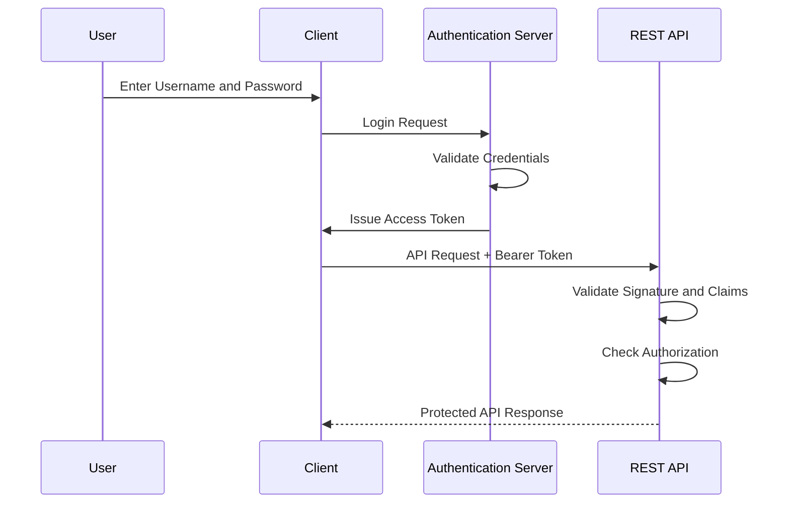

### 5.2.8 Sending JWT in HTTP Requests

The client generally sends the access token through the Authorization header.

```http
GET /api/employees HTTP/1.1
Host: api.company.in
Authorization: Bearer <access-token>
Accept: application/json
```

The server validates the token before allowing access to protected resources.

### 5.2.9 JWT Validation

A secure JWT validation process should verify:

1. Signature: The token must have a valid signature.
2. Issuer: The token must come from a trusted issuer.
3. Audience: The token must be intended for the API receiving it.
4. Expiration: The token must not have expired.
5. Not Before: The token must not be used before its validity period.
6. Algorithm: Only explicitly permitted signing algorithms should be accepted.
7. Permissions: Required roles, scopes, or claims must be present.

### 5.2.10 Access Token vs Refresh Token

An access token is used to access protected APIs.

A refresh token is used to obtain a new access token through the authorization server.

| Access Token | Refresh Token |
|---|---|
| Sent to resource APIs | Sent to authorization server |
| Usually short-lived | Can have a longer lifetime |
| Grants access to protected resources | Obtains new access tokens |
| Should be carefully protected | Requires particularly careful protection |

Refresh tokens should be stored securely and rotated or revoked according to the identity provider's security policies.

### 5.2.11 JWT Security Best Practices

- Use HTTPS for all token transmission. Tokens must not be sent over unencrypted connections.
- Keep access-token lifetimes reasonably short. This limits the impact of token exposure.
- Store tokens carefully. Browser storage decisions should consider cross-site scripting and cross-site request forgery risks.
- Never trust token claims before validating the token. A client can modify the encoded payload, so authorization must depend on validated claims.
- Validate the issuer and audience. A token intended for another application should not be accepted.
- Implement refresh-token rotation and revocation where supported. This helps reduce the risk of stolen long-lived credentials.
- Avoid logging complete access or refresh tokens. Logs should not become a source of credential leakage.

### Real-World Example

Rahul logs in to an employee portal using his corporate account.

The identity provider authenticates him and issues an access token. The Angular application sends the token when requesting employee information from the .NET REST API.

The API validates the token and checks whether Rahul has the required permission.

---

## 5.3 JWT Implementation in ASP.NET Core – Conceptual Example

Consider a .NET REST API that needs to protect employee information.

The API uses JWT bearer authentication.

### 5.3.1 Install Required Package

```bash
dotnet add package Microsoft.AspNetCore.Authentication.JwtBearer
```

Use a package version compatible with the target .NET framework.

### 5.3.2 Configure JWT Authentication

Example `appsettings.json`:

```json
{
  "Jwt": {
    "Issuer": "https://identity.company.in",
    "Audience": "employee-api"
  }
}
```

The signing key should be supplied through a secure configuration provider, such as a secret manager or environment variable, rather than committed to source control.

### 5.3.3 Configure Authentication in Program.cs

```csharp
using Microsoft.AspNetCore.Authentication.JwtBearer;
using Microsoft.IdentityModel.Tokens;
using System.Text;

var builder = WebApplication.CreateBuilder(args);

var jwtIssuer =
    builder.Configuration["Jwt:Issuer"];

var jwtAudience =
    builder.Configuration["Jwt:Audience"];

var jwtKey =
    builder.Configuration["Jwt:SigningKey"]
    ?? throw new InvalidOperationException(
        "JWT signing key is not configured.");

builder.Services
    .AddAuthentication(JwtBearerDefaults.AuthenticationScheme)
    .AddJwtBearer(options =>
    {
        options.TokenValidationParameters =
            new TokenValidationParameters
            {
                ValidateIssuer = true,
                ValidIssuer = jwtIssuer,

                ValidateAudience = true,
                ValidAudience = jwtAudience,

                ValidateLifetime = true,

                ValidateIssuerSigningKey = true,

                IssuerSigningKey = new SymmetricSecurityKey(
                    Encoding.UTF8.GetBytes(jwtKey)
                ),

                ClockSkew = TimeSpan.FromMinutes(1)
            };
    });

builder.Services.AddAuthorization();

builder.Services.AddControllers();

var app = builder.Build();

app.UseHttpsRedirection();

app.UseAuthentication();

app.UseAuthorization();

app.MapControllers();

app.Run();
```

This example assumes the application has a properly configured signing key and token issuer.

In production, asymmetric signing and a dedicated identity provider are often preferable to sharing one symmetric signing secret across multiple services.

### 5.3.4 Create a Protected API Controller

```csharp
using Microsoft.AspNetCore.Authorization;
using Microsoft.AspNetCore.Mvc;

[ApiController]
[Route("api/employees")]
public class EmployeeController : ControllerBase
{
    [HttpGet]
    [Authorize]
    public IActionResult GetEmployees()
    {
        var employees = new[]
        {
            new
            {
                EmployeeId = 101,
                EmployeeName = "Rahul Sharma",
                City = "Bengaluru"
            },
            new
            {
                EmployeeId = 102,
                EmployeeName = "Sneha Rao",
                City = "Mysuru"
            }
        };

        return Ok(employees);
    }
}
```

The `[Authorize]` attribute requires an authenticated principal.

The application must configure a trusted authentication scheme that validates the supplied token.

### 5.3.5 Role-Based Authorization

The application can restrict operations based on roles.

```csharp
[HttpDelete("{id}")]
[Authorize(Roles = "Admin")]
public IActionResult DeleteEmployee(int id)
{
    return NoContent();
}
```

Only users whose validated identity has the required `Admin` role can access this endpoint.

### Real-World Example

An employee can retrieve employee directory information, but only an administrator can delete employee records. The API uses authentication to identify the user and role-based authorization to control access.

---

# MODULE 6: HANDS-ON PRACTICAL LABS

# **Module 6: Practical REST API Development – End-to-End Implementation**

This module focuses on implementing a complete REST API using **ASP.NET Core Web API, C#, SQL Server, JSON, and JWT authentication**.

The objective is to bring together the concepts covered in Modules 1–5 and demonstrate how they work in an actual application.

By the end of this module, learners should be able to:

- Create an ASP.NET Core Web API project.
- Understand the architecture and responsibilities of API components.
- Implement CRUD operations using HTTP methods.
- Work with JSON request and response payloads.
- Connect REST APIs to SQL Server using Entity Framework Core.
- Implement input validation and error handling.
- Document APIs using OpenAPI and Swagger UI.
- Secure API endpoints using JWT authentication and authorization.
- Test APIs using Postman.

## **6.1 Project Scenario – Employee Management REST API**

Consider an IT organization with offices in Bengaluru, Chennai, Hyderabad, and Pune.

The organization wants to develop an Employee Management System that allows HR administrators to manage employee information through a web application.

The organization has decided to expose employee-related functionality through REST APIs so that multiple applications can consume the same backend services.

### **Business Requirements**

The Employee Management API should support the following operations:

| Requirement             | Description                             |
| ----------------------- | --------------------------------------- |
| Create Employee         | Register a new employee                 |
| Retrieve Employees      | Retrieve all employee records           |
| Retrieve Employee by ID | Retrieve an individual employee         |
| Update Employee         | Modify existing employee details        |
| Delete Employee         | Remove an employee record               |
| Search Employees        | Search employees by name or city        |
| Authentication          | Allow users to log in                   |
| Authorization           | Restrict operations based on user roles |

### **Real-World Example**

An HR administrator named Priya works in the Bengaluru office.

She uses an Angular application to register a new employee named Ravi Kumar, who joins the development team in Chennai.

The Angular application sends an HTTP POST request to the Employee Management API.

The API validates the incoming information, stores the employee record in SQL Server, and returns a successful response.

The same API can later be consumed by a mobile application without implementing the employee business logic again.

## **6.2 Overall System Architecture**

Before implementing the application, let's understand the architecture.

[Project Architecture Diagram In Net Asp Net Mvc Architecture](https://images.openai.com/static-rsc-4/0DBT7y3i8RDyWDgC4AXcRDVDQ8RuzTzBneKEzl2NqSkbDPr0NG1cc9_2WsNQhQYHFwC_Ya7fh-_z8yeJgLUkG4Cph7x7BZOxrFdbz9zkN0gJVMiHCJlrWMwJL5eg7UoIi7DCAmGD0XYC4L6XHt95TdeVvRSEvIUGITd5PtvptRk?purpose=inline)

[neo005kmquser.z21.web.core.windows.net](https://neo005kmquser.z21.web.core.windows.net/project-architecture-diagram-in-net.html?utm_source=chatgpt.com)

The application follows a layered architecture to separate responsibilities.

### **Architecture Components**

**1. Client Application**

The client application represents the frontend consuming the REST API. It can be developed using Angular, React, Blazor, or a mobile application framework.

**2. API Controller**

The controller receives HTTP requests and returns HTTP responses. It maps incoming requests to the appropriate business operations and should avoid containing extensive business logic.

**3. Service Layer**

The service layer implements business rules and application workflows. For example, it checks whether an employee exists before updating or deleting an employee record.

**4. Repository / Data Access Layer**

This layer manages database communication. In this implementation, Entity Framework Core will be used to communicate with SQL Server.

**5. Database**

SQL Server stores employee information persistently. Unlike an in-memory collection, database records remain available after the API application restarts.

### **Request Processing Flow**


### **Real-World Example**

When Priya retrieves employee details, the request travels from the Angular application to the controller.

The controller invokes the employee service, which retrieves the required record through Entity Framework Core.

The result is returned as JSON to the Angular application.

## **6.3 Development Environment and Prerequisites**

Before starting implementation, ensure that the following software is available.

| Software                             | Purpose                    |
| ------------------------------------ | -------------------------- |
| Visual Studio 2022                   | Application development    |
| .NET 10 SDK or compatible target SDK | Build and run ASP.NET Core |
| SQL Server Developer Edition         | Database                   |
| SQL Server Management Studio         | Database management        |
| Postman                              | API testing                |
| Browser                              | Swagger UI                 |
| Git                                  | Source control             |

For the implementation, we will use ASP.NET Core Web API with Entity Framework Core.

### **Verify .NET Installation**

Open PowerShell or Visual Studio Developer PowerShell.

Execute:

```
dotnet --version
```

To check all installed SDKs:

```
dotnet --list-sdks
```

### **Create a New Web API Project**

Open Visual Studio.

1. Select **Create a new project**.
2. Search for ASP.NET Core Web API.
3. Select the Web API template.
4. Enter the project name as `EmployeeManagement.API`.
5. Select the target framework.
6. Enable OpenAPI support if the template provides the option.
7. Create the project.

Alternatively, execute:

```
dotnet new webapi -n EmployeeManagement.API
cd EmployeeManagement.API
```

### **Real-World Example**

A development team can use the same project template to create APIs for employee management, inventory management, customer management, and order processing.

The underlying architecture remains similar even though the business requirements differ.

## **6.4 Recommended Project Structure**

A well-organized project makes it easier to maintain and extend the application.

Create the following folder structure:

```
EmployeeManagement.API/
│
├── Controllers/
│   ├── AuthController.cs
│   └── EmployeesController.cs
│
├── Models/
│   └── Employee.cs
│
├── DTOs/
│   ├── EmployeeRequest.cs
│   ├── EmployeeResponse.cs
│   └── UpdateEmployeeRequest.cs
│
├── Services/
│   ├── IEmployeeService.cs
│   └── EmployeeService.cs
│
├── Data/
│   └── EmployeeDbContext.cs
│
├── Middleware/
│   └── GlobalExceptionMiddleware.cs
│
├── appsettings.json
│
└── Program.cs
```

### **Understanding Each Folder**

| Folder / File    | Responsibility                                 |
| ---------------- | ---------------------------------------------- |
| Controllers      | Handles HTTP requests and responses            |
| Models           | Contains business entities                     |
| DTOs             | Defines API request and response structures    |
| Services         | Implements business logic                      |
| Data             | Manages database communication                 |
| Middleware       | Handles cross-cutting concerns                 |
| Program.cs       | Configures application services and middleware |
| appsettings.json | Contains application configuration             |

### **Why Should We Separate These Responsibilities?**

Imagine that all application logic is written inside one controller.

As the application grows, the controller becomes difficult to maintain because it contains HTTP processing, business rules, database queries, and validation.

Separating these responsibilities makes the application easier to test, modify, and extend.

### **Real-World Example**

Suppose the organization wants to introduce a new requirement: employees should not be registered with duplicate email addresses.

If the business logic is implemented in the service layer, developers can modify the validation rule without changing the controller's responsibilities.

## **6.5 Create the Employee Model**

A model represents the business entity used by the application.

In our scenario, the Employee model represents an employee record stored in SQL Server.

Create a file named `Employee.cs` inside the Models folder.

```
namespace EmployeeManagement.API.Models;

public class Employee
{
    public int EmployeeId { get; set; }

    public string EmployeeName { get; set; } = string.Empty;

    public string Email { get; set; } = string.Empty;

    public string Department { get; set; } = string.Empty;

    public string City { get; set; } = string.Empty;

    public DateTime CreatedDate { get; set; }
}
```

### **Understanding the Properties**

| Property     | Data Type | Purpose                     |
| ------------ | --------- | --------------------------- |
| EmployeeId   | int       | Unique employee identifier  |
| EmployeeName | string    | Employee's full name        |
| Email        | string    | Employee's email address    |
| Department   | string    | Employee's department       |
| City         | string    | Employee's working location |
| CreatedDate  | DateTime  | Record creation timestamp   |

### **How Does This Model Relate to the Database?**

Entity Framework Core uses the Employee class to represent an entity in the database.

By default, EF Core can create a table named `Employees` with columns corresponding to the model properties.

The `EmployeeId` property is conventionally recognized as the primary key.

### **Real-World Example**

When Priya registers Ravi Kumar, the API creates an Employee object containing his name, email address, department, and city.

Entity Framework Core converts this object into a database insert operation.

## **6.6 Create Data Transfer Objects (DTOs)**

Before implementing controllers, it is important to understand DTOs.

DTO stands for **Data Transfer Object**.

A DTO is an object used to transfer information between different application layers or between an API and its consumer.

### **Why Do We Need DTOs?**

Consider an Employee database entity containing:

```
public class Employee
{
    public int EmployeeId { get; set; }

    public string EmployeeName { get; set; }

    public string Email { get; set; }

    public string Department { get; set; }

    public string City { get; set; }

    public DateTime CreatedDate { get; set; }

    public string InternalNotes { get; set; }
}
```

Should the API expose every property to the client?

No.

For example, `InternalNotes` may contain confidential organizational information.

DTOs allow us to control which properties are accepted from clients and which properties are returned.

### **Create EmployeeRequest.cs**

This DTO represents the data accepted when creating an employee.

```
using System.ComponentModel.DataAnnotations;

namespace EmployeeManagement.API.DTOs;

public class EmployeeRequest
{
    [Required]
    [StringLength(100, MinimumLength = 3)]
    public string EmployeeName { get; set; } = string.Empty;

    [Required]
    [EmailAddress]
    public string Email { get; set; } = string.Empty;

    [Required]
    [StringLength(50)]
    public string Department { get; set; } = string.Empty;

    [Required]
    [StringLength(50)]
    public string City { get; set; } = string.Empty;
}
```

### **Create EmployeeResponse.cs**

This DTO represents the information returned to the API consumer.

```
namespace EmployeeManagement.API.DTOs;

public class EmployeeResponse
{
    public int EmployeeId { get; set; }

    public string EmployeeName { get; set; } = string.Empty;

    public string Email { get; set; } = string.Empty;

    public string Department { get; set; } = string.Empty;

    public string City { get; set; } = string.Empty;

    public DateTime CreatedDate { get; set; }
}
```

### **Create UpdateEmployeeRequest.cs**

For updating an employee, we can use a separate DTO.

```
using System.ComponentModel.DataAnnotations;

namespace EmployeeManagement.API.DTOs;

public class UpdateEmployeeRequest
{
    [Required]
    [StringLength(100, MinimumLength = 3)]
    public string EmployeeName { get; set; } = string.Empty;

    [Required]
    [EmailAddress]
    public string Email { get; set; } = string.Empty;

    [Required]
    [StringLength(50)]
    public string Department { get; set; } = string.Empty;

    [Required]
    [StringLength(50)]
    public string City { get; set; } = string.Empty;
}
```

### **DTO vs Model**

| Feature             | Model / Entity                            | DTO                                  |
| ------------------- | ----------------------------------------- | ------------------------------------ |
| Primary purpose     | Represents application or database entity | Transfers data                       |
| Database mapping    | Commonly mapped by EF Core                | Not normally mapped directly         |
| Internal properties | May contain internal fields               | Exposes only required fields         |
| Validation          | May contain persistence rules             | Commonly contains request validation |
| API usage           | Should not automatically be exposed       | Designed for API communication       |

### **Real-World Example**

When an employee is registered, the frontend sends an EmployeeRequest.

The service converts it into an Employee entity.

After saving it in SQL Server, the API converts the entity into an EmployeeResponse and sends the response to the client.

## **6.7 Configure SQL Server Database Connectivity**

Now that the model and DTOs are ready, we need to configure the database.

We will use Entity Framework Core to communicate with SQL Server.

### **Step 1: Create the Database**

Open SQL Server Management Studio.

Connect to the local SQL Server instance and execute:

```
CREATE DATABASE EmployeeManagementDB;
GO
```

This creates the database that will store employee records.

### **Step 2: Install Entity Framework Core Packages**

Open the Package Manager Console in Visual Studio.

Execute:

```
Install-Package Microsoft.EntityFrameworkCore.SqlServer

Install-Package Microsoft.EntityFrameworkCore.Tools

Install-Package Microsoft.EntityFrameworkCore.Design
```

Alternatively, use the .NET CLI:

```
dotnet add package Microsoft.EntityFrameworkCore.SqlServer

dotnet add package Microsoft.EntityFrameworkCore.Tools

dotnet add package Microsoft.EntityFrameworkCore.Design
```

Ensure that all EF Core packages use compatible versions matching the target framework and one another.

### **Step 3: Configure the Connection String**

Open `appsettings.json`.

Add the following configuration:

```
{
  "ConnectionStrings": {
    "DefaultConnection": "Server=localhost;Database=EmployeeManagementDB;Trusted_Connection=True;TrustServerCertificate=True;"
  }
}
```

For a named SQL Server instance, use:

```
{
  "ConnectionStrings": {
    "DefaultConnection": "Server=localhost\\SQLEXPRESS;Database=EmployeeManagementDB;Trusted_Connection=True;TrustServerCertificate=True;"
  }
}
```

The actual connection string depends on the SQL Server instance installed on the participant's machine.

For production, use appropriate certificate validation rather than relying on `TrustServerCertificate=True`, and keep credentials outside source-controlled configuration files.

### **Understanding the Connection String**

| Parameter              | Purpose                                  |
| ---------------------- | ---------------------------------------- |
| Server                 | SQL Server instance name                 |
| Database               | Database name                            |
| Trusted_Connection     | Uses Windows authentication              |
| TrustServerCertificate | Controls certificate validation behavior |

### **Step 4: Create EmployeeDbContext.cs**

A DbContext represents a session with the database.

It manages entity tracking, querying, inserting, updating, and deleting records.

Create `EmployeeDbContext.cs` inside the Data folder.

```
using Microsoft.EntityFrameworkCore;
using EmployeeManagement.API.Models;

namespace EmployeeManagement.API.Data;

public class EmployeeDbContext : DbContext
{
    public EmployeeDbContext(
        DbContextOptions<EmployeeDbContext> options)
        : base(options)
    {
    }

    public DbSet<Employee> Employees { get; set; }
}
```

### **Understanding DbSet**

```
public DbSet<Employee> Employees { get; set; }
```

This property represents the Employees collection in the database.

It allows developers to execute operations such as:

```
_dbContext.Employees.ToListAsync();

_dbContext.Employees.Add(employee);

_dbContext.Employees.Remove(employee);
```

Entity Framework Core translates these operations into appropriate SQL commands.

### **Step 5: Configure Database Connection in Program.cs**

Add the following configuration:

```
using EmployeeManagement.API.Data;
using Microsoft.EntityFrameworkCore;

var builder = WebApplication.CreateBuilder(args);

builder.Services.AddControllers();

builder.Services.AddDbContext<EmployeeDbContext>(options =>
    options.UseSqlServer(
        builder.Configuration.GetConnectionString(
            "DefaultConnection")));

var app = builder.Build();

app.UseHttpsRedirection();

app.MapControllers();

app.Run();
```

The `AddDbContext` method registers EmployeeDbContext with the dependency injection container.

ASP.NET Core can now provide the DbContext to other application components through constructor injection.

### **Step 6: Create Database Migration**

Open Package Manager Console.

Execute:

```
Add-Migration InitialCreate

Update-Database
```

Alternatively:

```
dotnet ef migrations add InitialCreate

dotnet ef database update
```

The migration process generates the necessary database schema based on the Employee model.

[How to Perform CRUD Operations with Entity Framework and ASP.NET Core | ComponentOne](https://images.openai.com/static-rsc-4/9H56FJSXWCO6OWfFdDRx9n_QXRWliWVyhrFl6soQcCALf5p4N3UaTF0bGje_IvjNlbow8o9ovN_MF8leYXMTP59ic8rmuBr9xJi-Lh5V4Pw8W32ENvPvLJFdaI0dlM7wBxBkPF_X0sMzh7SjpGf29UjjCIIk0IID6iS2qwxjdlk?purpose=inline)

[developer.mescius.com](https://developer.mescius.com/blogs/how-to-perform-crud-operations-with-entity-framework-and-aspnet-core?utm_source=chatgpt.com)

### **Verify the Database**

Open SSMS and execute:

```
USE EmployeeManagementDB;
GO

SELECT * FROM Employees;
```

Initially, the table will be empty.

Checkpoint

At this stage, learners should have:

- Created an ASP.NET Core Web API project.
- Created the Employee model.
- Configured SQL Server connectivity.
- Created the EmployeeDbContext.
- Generated the Employees database table using EF Core migrations.

### **Real-World Example**

When the API receives an employee registration request, Entity Framework Core communicates with SQL Server and stores the employee record.

The developer does not need to write the INSERT statement manually for this basic operation.

## **6.8 Implement the Service Layer**

The service layer contains business logic.

It separates application rules from HTTP request handling and database operations.

### **Why Do We Need a Service Layer?**

Consider a requirement that employee email addresses must be unique.

We could write the duplicate-email validation directly inside the controller.

However, this creates tight coupling between HTTP processing and business rules.

A service layer provides a central location for these rules and allows the same logic to be reused by multiple controllers or other application components.

### **Step 1: Create IEmployeeService.cs**

This interface defines the operations supported by the employee service.

```
using EmployeeManagement.API.DTOs;

namespace EmployeeManagement.API.Services;

public interface IEmployeeService
{
    Task<List<EmployeeResponse>> GetAllAsync();

    Task<EmployeeResponse?> GetByIdAsync(int id);

    Task<EmployeeResponse> CreateAsync(
        EmployeeRequest request);

    Task<EmployeeResponse?> UpdateAsync(
        int id,
        UpdateEmployeeRequest request);

    Task<bool> DeleteAsync(int id);
}
```

### **Understanding the Interface**

| Method       | Responsibility               |
| ------------ | ---------------------------- |
| GetAllAsync  | Retrieves all employees      |
| GetByIdAsync | Retrieves one employee       |
| CreateAsync  | Creates a new employee       |
| UpdateAsync  | Updates an existing employee |
| DeleteAsync  | Deletes an employee          |

The interface defines what the service can do without specifying how the operations are implemented.

### **Step 2: Implement EmployeeService.cs**

Create the implementation inside the Services folder.

```
using EmployeeManagement.API.Data;
using EmployeeManagement.API.DTOs;
using EmployeeManagement.API.Models;
using Microsoft.EntityFrameworkCore;

namespace EmployeeManagement.API.Services;

public class EmployeeService : IEmployeeService
{
    private readonly EmployeeDbContext _context;

    public EmployeeService(EmployeeDbContext context)
    {
        _context = context;
    }

    public async Task<List<EmployeeResponse>> GetAllAsync()
    {
        return await _context.Employees
            .AsNoTracking()
            .Select(e => new EmployeeResponse
            {
                EmployeeId = e.EmployeeId,
                EmployeeName = e.EmployeeName,
                Email = e.Email,
                Department = e.Department,
                City = e.City,
                CreatedDate = e.CreatedDate
            })
            .ToListAsync();
    }

    public async Task<EmployeeResponse?> GetByIdAsync(int id)
    {
        return await _context.Employees
            .AsNoTracking()
            .Where(e => e.EmployeeId == id)
            .Select(e => new EmployeeResponse
            {
                EmployeeId = e.EmployeeId,
                EmployeeName = e.EmployeeName,
                Email = e.Email,
                Department = e.Department,
                City = e.City,
                CreatedDate = e.CreatedDate
            })
            .FirstOrDefaultAsync();
    }

    public async Task<EmployeeResponse> CreateAsync(
        EmployeeRequest request)
    {
        bool emailExists = await _context.Employees
            .AnyAsync(e => e.Email == request.Email);

        if (emailExists)
        {
            throw new InvalidOperationException(
                "An employee with this email already exists.");
        }

        var employee = new Employee
        {
            EmployeeName = request.EmployeeName,
            Email = request.Email,
            Department = request.Department,
            City = request.City,
            CreatedDate = DateTime.UtcNow
        };

        _context.Employees.Add(employee);

        await _context.SaveChangesAsync();

        return new EmployeeResponse
        {
            EmployeeId = employee.EmployeeId,
            EmployeeName = employee.EmployeeName,
            Email = employee.Email,
            Department = employee.Department,
            City = employee.City,
            CreatedDate = employee.CreatedDate
        };
    }

    public async Task<EmployeeResponse?> UpdateAsync(
        int id,
        UpdateEmployeeRequest request)
    {
        var employee = await _context.Employees
            .FirstOrDefaultAsync(e => e.EmployeeId == id);

        if (employee == null)
            return null;

        bool emailExists = await _context.Employees
            .AnyAsync(e =>
                e.Email == request.Email &&
                e.EmployeeId != id);

        if (emailExists)
        {
            throw new InvalidOperationException(
                "Email is already used by another employee.");
        }

        employee.EmployeeName = request.EmployeeName;
        employee.Email = request.Email;
        employee.Department = request.Department;
        employee.City = request.City;

        await _context.SaveChangesAsync();

        return new EmployeeResponse
        {
            EmployeeId = employee.EmployeeId,
            EmployeeName = employee.EmployeeName,
            Email = employee.Email,
            Department = employee.Department,
            City = employee.City,
            CreatedDate = employee.CreatedDate
        };
    }

    public async Task<bool> DeleteAsync(int id)
    {
        var employee = await _context.Employees
            .FirstOrDefaultAsync(e => e.EmployeeId == id);

        if (employee == null)
            return false;

        _context.Employees.Remove(employee);

        await _context.SaveChangesAsync();

        return true;
    }
}
```

### **Important Concepts Used**

**Dependency Injection**

The EmployeeDbContext is supplied through the constructor rather than being created manually.

This reduces coupling and makes the service easier to test.

**Asynchronous Programming**

Methods such as `ToListAsync()` and `SaveChangesAsync()` allow database operations to execute asynchronously.

This helps the application handle multiple requests efficiently without blocking request-processing threads while waiting for I/O operations.

**AsNoTracking()**

This method tells EF Core not to track the returned entities.

It is useful for read-only queries because it reduces unnecessary change-tracking overhead.

**LINQ**

LINQ allows developers to query application data using C# expressions.

For example:

```
_context.Employees
    .Where(e => e.City == "Bengaluru")
    .ToListAsync();
```

This retrieves employees working in Bengaluru.

### **Step 3: Register the Service in Program.cs**

Add:

```
builder.Services.AddScoped<
    IEmployeeService,
    EmployeeService>();
```

`AddScoped` creates one service instance per HTTP request scope.

### **Real-World Example**

Suppose the HR team introduces a rule that only employees belonging to approved departments can be registered.

This rule can be implemented inside EmployeeService without changing how the controller receives HTTP requests.

## **6.9 Implement Employee REST API Controller**

Now that the service layer is ready, we can create the controller that exposes employee operations through HTTP endpoints.

Create `EmployeesController.cs` inside the Controllers folder.

```
using EmployeeManagement.API.DTOs;
using EmployeeManagement.API.Services;
using Microsoft.AspNetCore.Mvc;

namespace EmployeeManagement.API.Controllers;

[ApiController]
[Route("api/v1/employees")]
public class EmployeesController : ControllerBase
{
    private readonly IEmployeeService _employeeService;

    public EmployeesController(
        IEmployeeService employeeService)
    {
        _employeeService = employeeService;
    }

    // GET: api/v1/employees

    [HttpGet]
    [ProducesResponseType(typeof(List<EmployeeResponse>), 200)]
    public async Task<IActionResult> GetAll()
    {
        var employees =
            await _employeeService.GetAllAsync();

        return Ok(employees);
    }

    // GET: api/v1/employees/101

    [HttpGet("{id:int}")]
    [ProducesResponseType(typeof(EmployeeResponse), 200)]
    [ProducesResponseType(404)]
    public async Task<IActionResult> GetById(int id)
    {
        var employee =
            await _employeeService.GetByIdAsync(id);

        if (employee == null)
            return NotFound();

        return Ok(employee);
    }

    // POST: api/v1/employees

    [HttpPost]
    [ProducesResponseType(typeof(EmployeeResponse), 201)]
    [ProducesResponseType(400)]
    [ProducesResponseType(409)]
    public async Task<IActionResult> Create(
        EmployeeRequest request)
    {
        var employee =
            await _employeeService.CreateAsync(request);

        return CreatedAtAction(
            nameof(GetById),
            new { id = employee.EmployeeId },
            employee);
    }

    // PUT: api/v1/employees/101

    [HttpPut("{id:int}")]
    [ProducesResponseType(typeof(EmployeeResponse), 200)]
    [ProducesResponseType(404)]
    public async Task<IActionResult> Update(
        int id,
        UpdateEmployeeRequest request)
    {
        var employee =
            await _employeeService.UpdateAsync(id, request);

        if (employee == null)
            return NotFound();

        return Ok(employee);
    }

    // PATCH: api/v1/employees/101/city

    [HttpPatch("{id:int}/city")]
    [ProducesResponseType(typeof(EmployeeResponse), 200)]
    [ProducesResponseType(404)]
    public async Task<IActionResult> UpdateCity(
        int id,
        UpdateEmployeeCityRequest request)
    {
        var employee =
            await _employeeService.UpdateCityAsync(
                id, request.City);

        if (employee == null)
            return NotFound();

        return Ok(employee);
    }

    // DELETE: api/v1/employees/101

    [HttpDelete("{id:int}")]
    [ProducesResponseType(204)]
    [ProducesResponseType(404)]
    public async Task<IActionResult> Delete(int id)
    {
        bool deleted =
            await _employeeService.DeleteAsync(id);

        if (!deleted)
            return NotFound();

        return NoContent();
    }
}
```

The PATCH action above requires two small additions to the service contract and implementation.

Create `UpdateEmployeeCityRequest.cs`:

```
using System.ComponentModel.DataAnnotations;

namespace EmployeeManagement.API.DTOs;

public class UpdateEmployeeCityRequest
{
    [Required]
    [StringLength(50)]
    public string City { get; set; } = string.Empty;
}
```

Add this method to `IEmployeeService`:

```
Task<EmployeeResponse?> UpdateCityAsync(
    int id,
    string city);
```

Add this implementation to `EmployeeService`:

```
public async Task<EmployeeResponse?> UpdateCityAsync(
    int id,
    string city)
{
    var employee = await _context.Employees
        .FirstOrDefaultAsync(e => e.EmployeeId == id);

    if (employee == null)
        return null;

    employee.City = city;

    await _context.SaveChangesAsync();

    return new EmployeeResponse
    {
        EmployeeId = employee.EmployeeId,
        EmployeeName = employee.EmployeeName,
        Email = employee.Email,
        Department = employee.Department,
        City = employee.City,
        CreatedDate = employee.CreatedDate
    };
}
```

### **Understanding the Controller**

| Attribute / Method  | Responsibility                                                                 |
| ------------------- | ------------------------------------------------------------------------------ |
| `[ApiController]`   | Enables API-specific behaviors, including automatic model validation responses |
| `[Route]`           | Defines the common endpoint route                                              |
| `[HttpGet]`         | Maps HTTP GET requests                                                         |
| `[HttpPost]`        | Maps HTTP POST requests                                                        |
| `[HttpPut]`         | Maps HTTP PUT requests                                                         |
| `[HttpPatch]`       | Maps HTTP PATCH requests                                                       |
| `[HttpDelete]`      | Maps HTTP DELETE requests                                                      |
| `Ok()`              | Returns HTTP 200                                                               |
| `CreatedAtAction()` | Returns HTTP 201 with a location identifying the new resource                  |
| `NotFound()`        | Returns HTTP 404                                                               |
| `NoContent()`       | Returns HTTP 204                                                               |

### **Understanding CreatedAtAction()**

Consider:

```
return CreatedAtAction(
    nameof(GetById),
    new { id = employee.EmployeeId },
    employee);
```

This method performs three important activities:

1. Returns HTTP 201 Created.
2. Includes the newly created employee in the response.
3. Generates a Location header pointing to the newly created resource.

Example:

```
HTTP/1.1 201 Created
Location: /api/v1/employees/101
```

### **Real-World Example**

Priya submits a request to register Ravi Kumar.

The POST endpoint invokes the service layer, which saves Ravi's information in SQL Server.

The controller returns HTTP 201 and provides the resource location so that the frontend can retrieve the newly created employee.

## **6.10 Configure Application Middleware and Services**

We now need to connect all the application components through the dependency injection container and configure the middleware pipeline.

Open `Program.cs`.

Use the following configuration:

```
using EmployeeManagement.API.Data;
using EmployeeManagement.API.Services;
using Microsoft.EntityFrameworkCore;

var builder = WebApplication.CreateBuilder(args);

// Register Controllers
builder.Services.AddControllers();

// Configure SQL Server
builder.Services.AddDbContext<EmployeeDbContext>(options =>
    options.UseSqlServer(
        builder.Configuration.GetConnectionString(
            "DefaultConnection")));

// Register Employee Service
builder.Services.AddScoped<
    IEmployeeService,
    EmployeeService>();

// Configure OpenAPI
builder.Services.AddEndpointsApiExplorer();
builder.Services.AddSwaggerGen();

var app = builder.Build();

// Configure Middleware Pipeline

if (app.Environment.IsDevelopment())
{
    app.UseSwagger();
    app.UseSwaggerUI();
}

app.UseHttpsRedirection();

app.UseAuthorization();

app.MapControllers();

app.Run();
```

The preceding configuration prepares the API for database access, controller execution, dependency injection, and Swagger documentation.

JWT authentication will be added in Section 6.15.

### **Understanding the Middleware Pipeline**

Middleware components execute as HTTP requests pass through the ASP.NET Core application.

\#chatgpt-mermaid-\_r_51e\_{font-family:-apple-system-body,ui-sans-serif,-apple-system,system-ui,"Segoe UI",Helvetica,"Apple Color Emoji",Arial,sans-serif,"Segoe UI Emoji","Segoe UI Symbol";font-size:16px;fill:rgb(13, 13, 13);}@keyframes edge-animation-frame{from{stroke-dashoffset:0;}}@keyframes dash{to{stroke-dashoffset:0;}}#chatgpt-mermaid-\_r_51e\_ .edge-animation-slow{stroke-dasharray:9,5!important;stroke-dashoffset:900;animation:dash 50s linear infinite;stroke-linecap:round;}#chatgpt-mermaid-\_r_51e\_ .edge-animation-fast{stroke-dasharray:9,5!important;stroke-dashoffset:900;animation:dash 20s linear infinite;stroke-linecap:round;}#chatgpt-mermaid-\_r_51e\_ .error-icon{fill:rgb(243, 243, 243);}#chatgpt-mermaid-\_r_51e\_ .error-text{fill:rgb(13, 13, 13);stroke:rgb(13, 13, 13);}#chatgpt-mermaid-\_r_51e\_ .edge-thickness-normal{stroke-width:1px;}#chatgpt-mermaid-\_r_51e\_ .edge-thickness-thick{stroke-width:3.5px;}#chatgpt-mermaid-\_r_51e\_ .edge-pattern-solid{stroke-dasharray:0;}#chatgpt-mermaid-\_r_51e\_ .edge-thickness-invisible{stroke-width:0;fill:none;}#chatgpt-mermaid-\_r_51e\_ .edge-pattern-dashed{stroke-dasharray:3;}#chatgpt-mermaid-\_r_51e\_ .edge-pattern-dotted{stroke-dasharray:2;}#chatgpt-mermaid-\_r_51e\_ .marker{fill:rgb(143, 143, 143);stroke:rgb(143, 143, 143);}#chatgpt-mermaid-\_r_51e\_ .marker.cross{stroke:rgb(143, 143, 143);}#chatgpt-mermaid-\_r_51e\_ svg{font-family:-apple-system-body,ui-sans-serif,-apple-system,system-ui,"Segoe UI",Helvetica,"Apple Color Emoji",Arial,sans-serif,"Segoe UI Emoji","Segoe UI Symbol";font-size:16px;}#chatgpt-mermaid-\_r_51e\_ p{margin:0;}#chatgpt-mermaid-\_r_51e\_ .label{font-family:-apple-system-body,ui-sans-serif,-apple-system,system-ui,"Segoe UI",Helvetica,"Apple Color Emoji",Arial,sans-serif,"Segoe UI Emoji","Segoe UI Symbol";color:rgb(13, 13, 13);}#chatgpt-mermaid-\_r_51e\_ .cluster-label text{fill:rgb(13, 13, 13);}#chatgpt-mermaid-\_r_51e\_ .cluster-label span{color:rgb(13, 13, 13);}#chatgpt-mermaid-\_r_51e\_ .cluster-label span p{background-color:transparent;}#chatgpt-mermaid-\_r_51e\_ .label text,#chatgpt-mermaid-\_r_51e\_ span{fill:rgb(13, 13, 13);color:rgb(13, 13, 13);}#chatgpt-mermaid-\_r_51e\_ .node rect,#chatgpt-mermaid-\_r_51e\_ .node circle,#chatgpt-mermaid-\_r_51e\_ .node ellipse,#chatgpt-mermaid-\_r_51e\_ .node polygon,#chatgpt-mermaid-\_r_51e\_ .node path{fill:rgb(222, 234, 251);stroke:rgb(83, 154, 248);stroke-width:1px;}#chatgpt-mermaid-\_r_51e\_ .rough-node .label text,#chatgpt-mermaid-\_r_51e\_ .node .label text,#chatgpt-mermaid-\_r_51e\_ .image-shape .label,#chatgpt-mermaid-\_r_51e\_ .icon-shape .label{text-anchor:middle;}#chatgpt-mermaid-\_r_51e\_ .node .katex path{fill:#000;stroke:#000;stroke-width:1px;}#chatgpt-mermaid-\_r_51e\_ .rough-node .label,#chatgpt-mermaid-\_r_51e\_ .node .label,#chatgpt-mermaid-\_r_51e\_ .image-shape .label,#chatgpt-mermaid-\_r_51e\_ .icon-shape .label{text-align:center;}#chatgpt-mermaid-\_r_51e\_ .node.clickable{cursor:pointer;}#chatgpt-mermaid-\_r_51e\_ .root .anchor path{fill:rgb(143, 143, 143)!important;stroke-width:0;stroke:rgb(143, 143, 143);}#chatgpt-mermaid-\_r_51e\_ .arrowheadPath{fill:rgb(143, 143, 143);}#chatgpt-mermaid-\_r_51e\_ .edgePath .path{stroke:rgb(143, 143, 143);stroke-width:1px;}#chatgpt-mermaid-\_r_51e\_ .flowchart-link{stroke:rgb(143, 143, 143);fill:none;}#chatgpt-mermaid-\_r_51e\_ .edgeLabel{background-color:rgb(252, 252, 252);text-align:center;}#chatgpt-mermaid-\_r_51e\_ .edgeLabel p{background-color:rgb(252, 252, 252);}#chatgpt-mermaid-\_r_51e\_ .edgeLabel rect{opacity:0.5;background-color:rgb(252, 252, 252);fill:rgb(252, 252, 252);}#chatgpt-mermaid-\_r_51e\_ .labelBkg{background-color:rgba(252, 252, 252, 0.5);}#chatgpt-mermaid-\_r_51e\_ .cluster rect{fill:rgb(243, 243, 243);stroke:rgba(0, 0, 0, 0.1);stroke-width:1px;}#chatgpt-mermaid-\_r_51e\_ .cluster text{fill:rgb(13, 13, 13);}#chatgpt-mermaid-\_r_51e\_ .cluster span{color:rgb(13, 13, 13);}#chatgpt-mermaid-\_r_51e\_ div.mermaidTooltip{position:absolute;text-align:center;max-width:200px;padding:2px;font-family:-apple-system-body,ui-sans-serif,-apple-system,system-ui,"Segoe UI",Helvetica,"Apple Color Emoji",Arial,sans-serif,"Segoe UI Emoji","Segoe UI Symbol";font-size:12px;background:rgb(243, 243, 243);border:1px solid rgba(0, 0, 0, 0.1);border-radius:2px;pointer-events:none;z-index:100;}#chatgpt-mermaid-\_r_51e\_ .flowchartTitleText{text-anchor:middle;font-size:18px;fill:rgb(13, 13, 13);}#chatgpt-mermaid-\_r_51e\_ rect.text{fill:none;stroke-width:0;}#chatgpt-mermaid-\_r_51e\_ .icon-shape,#chatgpt-mermaid-\_r_51e\_ .image-shape{background-color:rgb(252, 252, 252);text-align:center;}#chatgpt-mermaid-\_r_51e\_ .icon-shape p,#chatgpt-mermaid-\_r_51e\_ .image-shape p{background-color:rgb(252, 252, 252);padding:2px;}#chatgpt-mermaid-\_r_51e\_ .icon-shape .label rect,#chatgpt-mermaid-\_r_51e\_ .image-shape .label rect{opacity:0.5;background-color:rgb(252, 252, 252);fill:rgb(252, 252, 252);}#chatgpt-mermaid-\_r_51e\_ .label-icon{display:inline-block;height:1em;overflow:visible;vertical-align:-0.125em;}#chatgpt-mermaid-\_r_51e\_ .node .label-icon path{fill:currentColor;stroke:revert;stroke-width:revert;}#chatgpt-mermaid-\_r_51e\_ .node .neo-node{stroke:rgb(83, 154, 248);}#chatgpt-mermaid-\_r_51e\_ [data-look="neo"].node rect,#chatgpt-mermaid-\_r_51e\_ [data-look="neo"].cluster rect,#chatgpt-mermaid-\_r_51e\_ [data-look="neo"].node polygon{stroke:url(#chatgpt-mermaid-\_r_51e\_-gradient);filter:drop-shadow( 1px 2px 2px rgba(185,185,185,1));}#chatgpt-mermaid-\_r_51e\_ [data-look="neo"].swimlane.cluster rect{filter:none;}#chatgpt-mermaid-\_r_51e\_ [data-look="neo"].node path{stroke:url(#chatgpt-mermaid-\_r_51e\_-gradient);stroke-width:1px;}#chatgpt-mermaid-\_r_51e\_ [data-look="neo"].node .outer-path{filter:drop-shadow( 1px 2px 2px rgba(185,185,185,1));}#chatgpt-mermaid-\_r_51e\_ [data-look="neo"].node .neo-line path{stroke:rgb(83, 154, 248);filter:none;}#chatgpt-mermaid-\_r_51e\_ [data-look="neo"].node circle{stroke:url(#chatgpt-mermaid-\_r_51e\_-gradient);filter:drop-shadow( 1px 2px 2px rgba(185,185,185,1));}#chatgpt-mermaid-\_r_51e\_ [data-look="neo"].node circle .state-start{fill:#000000;}#chatgpt-mermaid-\_r_51e\_ [data-look="neo"].icon-shape .icon{fill:url(#chatgpt-mermaid-\_r_51e\_-gradient);filter:drop-shadow( 1px 2px 2px rgba(185,185,185,1));}#chatgpt-mermaid-\_r_51e\_ [data-look="neo"].icon-shape .icon-neo path{stroke:url(#chatgpt-mermaid-\_r_51e\_-gradient);filter:drop-shadow( 1px 2px 2px rgba(185,185,185,1));}#chatgpt-mermaid-\_r_51e\_ .node text{font-size:14px;font-weight:600;letter-spacing:normal;fill:rgb(0, 79, 153);}#chatgpt-mermaid-\_r_51e\_ .edgeLabels text{font-size:13px;font-weight:600;letter-spacing:-0.08px;fill:rgb(0, 79, 153);}#chatgpt-mermaid-\_r_51e\_ .node tspan[font-weight="normal"],#chatgpt-mermaid-\_r_51e\_ .edgeLabels tspan[font-weight="normal"]{font-weight:600;}#chatgpt-mermaid-\_r_51e\_ .edgeLabel .label rect{opacity:1;rx:13px;ry:13px;fill:rgb(245, 250, 255);stroke:rgb(206, 219, 229);stroke-width:1px;}#chatgpt-mermaid-\_r_51e\_ .node rect,#chatgpt-mermaid-\_r_51e\_ .node circle,#chatgpt-mermaid-\_r_51e\_ .node ellipse,#chatgpt-mermaid-\_r_51e\_ .node polygon,#chatgpt-mermaid-\_r_51e\_ .node path{fill:rgb(229, 243, 255);stroke:rgba(0, 0, 0, 0.1);stroke-width:1px;}#chatgpt-mermaid-\_r_51e\_ .node rect{rx:16px;ry:16px;}#chatgpt-mermaid-\_r_51e\_ .mermaid-decision .label-container{fill:rgb(245, 250, 255);stroke:rgb(206, 219, 229);stroke-dasharray:2,2;}#chatgpt-mermaid-\_r_51e\_ .edgePaths .flowchart-link{stroke:rgb(143, 143, 143);stroke-width:1px;stroke-linecap:round;stroke-linejoin:round;}#chatgpt-mermaid-\_r_51e\_ .marker{fill:rgb(143, 143, 143);stroke:rgb(143, 143, 143);}#chatgpt-mermaid-\_r_51e\_ :root{--mermaid-font-family:-apple-system-body,ui-sans-serif,-apple-system,system-ui,"Segoe UI",Helvetica,"Apple Color Emoji",Arial,sans-serif,"Segoe UI Emoji","Segoe UI Symbol";}Incoming HTTP RequestHTTPS RedirectionSwagger MiddlewareAuthentication MiddlewareAuthorization MiddlewareControllerService LayerDatabaseHTTP Response

The actual middleware order depends on configuration and environment. Authentication must be placed before authorization.

### **Real-World Example**

When a request arrives at the Employee API, ASP.NET Core processes it through the configured middleware pipeline.

If the request requires authentication, the authentication middleware identifies the caller before authorization rules are evaluated.

## **6.11 Run and Test the REST API**

We have now implemented the basic CRUD operations.

Let's execute the application and test the endpoints.

### **Step 1: Run the Application**

In Visual Studio, press F5 or Ctrl + F5.

Alternatively, execute:

```
dotnet run
```

The application starts and displays its listening URL.

For example:

```
https://localhost:7001
```

The actual port will depend on your launch configuration.

### **Step 2: Open Swagger UI**

Open:

```
https://localhost:7001/swagger
```

Swagger UI displays the available endpoints.

[Getting Started with ASP.NET Core Web API: A Beginner's Guide](https://images.openai.com/static-rsc-4/pIjMFdrGmwjTh4UhCzy_NQM9cjP8a308_OSBQlbsRUviTZtcgbLYbDLwR74lXbSqrgwyj01u9CauaqyUUnFbqPllVepqv9s8kR43yFPAAST4xFSsFLtNm9n8YWXf-YZvv-1Me2WnwuLf2uJQEpUQ8Z1Ben2yOCE0TtaXmHkCSlU?purpose=inline)

[c-sharpcorner.com](https://www.c-sharpcorner.com/blogs/getting-started-with-asp-net-core-web-api-a-beginners-guide?utm_source=chatgpt.com)

Swagger UI allows developers to:

- Explore available endpoints.
- View HTTP methods.
- Understand request parameters.
- Enter JSON request bodies.
- Execute API calls.
- Inspect response status codes.
- Examine returned JSON data.

### **Step 3: Test GET – Retrieve All Employees**

Endpoint:

```
GET /api/v1/employees
```

Initially, the response should be an empty array:

```
[]
```

Expected status:

```
200 OK
```

### **Step 4: Test POST – Create an Employee**

Endpoint:

```
POST /api/v1/employees
```

Request:

```
{
  "employeeName": "Ravi Kumar",
  "email": "ravi@company.in",
  "department": "Development",
  "city": "Bengaluru"
}
```

Expected response:

```
{
  "employeeId": 1,
  "employeeName": "Ravi Kumar",
  "email": "ravi@company.in",
  "department": "Development",
  "city": "Bengaluru",
  "createdDate": "2026-11-25T09:00:00Z"
}
```

The employee ID is generated by SQL Server.

Expected status:

```
201 Created
```

### **Step 5: Test GET – Retrieve Employee by ID**

Endpoint:

```
GET /api/v1/employees/1
```

Expected response:

```
{
  "employeeId": 1,
  "employeeName": "Ravi Kumar",
  "email": "ravi@company.in",
  "department": "Development",
  "city": "Bengaluru",
  "createdDate": "2026-11-25T09:00:00Z"
}
```

Expected status:

```
200 OK
```

### **Step 6: Test PUT – Update Employee**

Endpoint:

```
PUT /api/v1/employees/1
```

Request:

```
{
  "employeeName": "Ravi Kumar",
  "email": "ravi@company.in",
  "department": "Architecture",
  "city": "Hyderabad"
}
```

Expected result: The employee's department and city are updated.

Expected status:

```
200 OK
```

### **Step 7: Test PATCH – Update Only City**

Endpoint:

```
PATCH /api/v1/employees/1/city
```

Request:

```
{
  "city": "Chennai"
}
```

Expected result: Only the city is modified. The other employee properties remain unchanged.

Expected status:

```
200 OK
```

### **Step 8: Test DELETE – Delete Employee**

Endpoint:

```
DELETE /api/v1/employees/1
```

Expected status:

```
204 No Content
```

### **Verify Database Records**

Open SSMS and execute:

```
USE EmployeeManagementDB;
GO

SELECT
    EmployeeId,
    EmployeeName,
    Email,
    Department,
    City,
    CreatedDate
FROM Employees;
```

You should be able to see the employee records created through the REST API.

Learning checkpoint

Participants should now understand how HTTP requests are mapped to controller actions, how services process business rules, how EF Core communicates with SQL Server, and how the API returns JSON responses.

### **Real-World Example**

An HR administrator creates, retrieves, updates, and deletes employee records through a web application.

Every operation is processed by the same REST API, regardless of whether the request originates from Angular, React, Postman, or another application.

## **6.12 Implement Input Validation**

A good REST API must validate incoming information before processing it.

Consider the following request:

```
{
  "employeeName": "",
  "email": "invalid-email",
  "department": "",
  "city": "Bengaluru"
}
```

This request should not be accepted because the employee name and department are missing and the email address is invalid.

### **How Does ASP.NET Core Perform Validation?**

We already added data annotations to our DTO:

```
[Required]
[StringLength(100, MinimumLength = 3)]
public string EmployeeName { get; set; }
```

These attributes define validation rules.

Because the controller uses `[ApiController]`, ASP.NET Core automatically checks model validation and normally returns HTTP 400 when the submitted model is invalid.

### **Example Validation Response**

```
{
  "type": "https://tools.ietf.org/html/rfc9110#section-15.5.1",
  "title": "One or more validation errors occurred.",
  "status": 400,
  "errors": {
    "EmployeeName": [
      "The EmployeeName field is required."
    ],
    "Email": [
      "The Email field is not a valid e-mail address."
    ]
  }
}
```

The exact error structure may vary based on framework configuration.

### **Additional Business Validation**

Data annotations handle common input validation.

However, business validation must also be implemented in the service layer.

Examples:

- Employee email must be unique.
- Department must be valid.
- Employee age must satisfy organizational policies.
- Employee status must follow business rules.

### **Database-Level Validation**

Application-level validation alone is not enough for important integrity rules.

For example, two requests might simultaneously attempt to register the same email address.

A database unique index should also enforce email uniqueness.

Add this configuration to `EmployeeDbContext`:

```
protected override void OnModelCreating(
    ModelBuilder modelBuilder)
{
    modelBuilder.Entity<Employee>()
        .HasIndex(e => e.Email)
        .IsUnique();
}
```

Then create and apply a new migration:

```
Add-Migration AddUniqueEmployeeEmail

Update-Database
```

### **Real-World Example**

Two HR administrators attempt to register the same employee using the same email address.

The service layer checks for duplicates, and the database unique index provides an additional guarantee against duplicate records.

## **6.13 Implement Centralized Exception Handling**

In a real-world application, exceptions may occur because of:

- Database connectivity problems.
- Invalid database operations.
- Duplicate records.
- External service failures.
- Unexpected application errors.

Handling exceptions separately inside every controller makes the application difficult to maintain.

ASP.NET Core provides middleware for centralized exception handling.

### **Why Do We Need Global Exception Handling?**

Consider an application with 30 controllers.

If every controller contains its own try-catch blocks, the same exception-handling logic may be repeated many times.

A global exception handler centralizes this responsibility.

### **Create GlobalExceptionMiddleware.cs**

```
using Microsoft.AspNetCore.Mvc;

namespace EmployeeManagement.API.Middleware;

public class GlobalExceptionMiddleware
{
    private readonly RequestDelegate _next;
    private readonly ILogger<GlobalExceptionMiddleware> _logger;

    public GlobalExceptionMiddleware(
        RequestDelegate next,
        ILogger<GlobalExceptionMiddleware> logger)
    {
        _next = next;
        _logger = logger;
    }

    public async Task InvokeAsync(HttpContext context)
    {
        try
        {
            await _next(context);
        }
        catch (InvalidOperationException ex)
        {
            _logger.LogWarning(
                ex,
                "Business conflict occurred.");

            await WriteProblemResponse(
                context,
                StatusCodes.Status409Conflict,
                "Business Conflict",
                ex.Message);
        }
        catch (Exception ex)
        {
            _logger.LogError(
                ex,
                "An unexpected error occurred.");

            await WriteProblemResponse(
                context,
                StatusCodes.Status500InternalServerError,
                "Internal Server Error",
                "An unexpected error occurred.");
        }
    }

    private static async Task WriteProblemResponse(
        HttpContext context,
        int statusCode,
        string title,
        string detail)
    {
        context.Response.Clear();

        context.Response.StatusCode = statusCode;

        context.Response.ContentType =
            "application/problem+json";

        var problem = new ProblemDetails
        {
            Status = statusCode,
            Title = title,
            Detail = detail,
            Instance = context.Request.Path
        };

        await context.Response.WriteAsJsonAsync(
            problem,
            contentType: "application/problem+json");
    }
}
```

### **Register Middleware in Program.cs**

Add the middleware before controller execution:

```
app.UseMiddleware<GlobalExceptionMiddleware>();
```

The relevant order becomes:

```
app.UseHttpsRedirection();

app.UseMiddleware<GlobalExceptionMiddleware>();

app.UseAuthentication();

app.UseAuthorization();

app.MapControllers();
```

The exception middleware must wrap the downstream middleware and endpoints whose exceptions it should handle.

### **Example Error Response**

If an employee is registered with a duplicate email address:

```
HTTP/1.1 409 Conflict
Content-Type: application/problem+json
```

```
{
  "type": "about:blank",
  "title": "Business Conflict",
  "status": 409,
  "detail": "An employee with this email already exists.",
  "instance": "/api/v1/employees"
}
```

### **Important Security Consideration**

Never return internal stack traces, SQL statements, connection strings, or confidential implementation details to API consumers.

Log detailed technical information internally and return safe error messages externally.

### **Real-World Example**

The SQL Server database becomes temporarily unavailable.

Instead of exposing a database exception to the frontend, the API logs the technical details and returns an appropriate server error response.

## **6.14 Document the API Using OpenAPI and Swagger UI**

Documentation is an important part of API development.

A developer consuming an API should be able to understand its endpoints, request formats, authentication requirements, and response structures without examining the backend source code.

OpenAPI provides a standardized description of HTTP APIs.

Swagger UI provides an interactive interface for exploring and testing documented endpoints.

### **Configure Swagger**

For the example application, install:

```
Install-Package Swashbuckle.AspNetCore
```

Configure services in `Program.cs`:

```
builder.Services.AddEndpointsApiExplorer();

builder.Services.AddSwaggerGen();
```

Configure middleware:

```
if (app.Environment.IsDevelopment())
{
    app.UseSwagger();

    app.UseSwaggerUI();
}
```

### **Access Swagger UI**

Run the application and open:

```
https://localhost:7001/swagger
```

Swagger UI will display the documented Employee Management endpoints.

### **Add API Metadata**

We can configure additional documentation details:

```
builder.Services.AddSwaggerGen(options =>
{
    options.SwaggerDoc(
        "v1",
        new Microsoft.OpenApi.Models.OpenApiInfo
        {
            Title = "Employee Management API",
            Version = "v1",
            Description =
                "REST API for managing employee information."
        });
});
```

### **What Should API Documentation Contain?**

| Documentation Element | Description                   |
| --------------------- | ----------------------------- |
| API Title             | Name of the API               |
| Version               | API version                   |
| Endpoint              | Available URL                 |
| HTTP Method           | GET, POST, PUT, PATCH, DELETE |
| Parameters            | Input values                  |
| Request Schema        | Expected JSON                 |
| Response Schema       | Returned JSON                 |
| Status Codes          | Possible HTTP responses       |
| Security              | Authentication requirements   |

### **Real-World Example**

A frontend developer working in Pune needs to integrate the Employee API.

Instead of asking the backend developer for every endpoint and JSON structure, the frontend developer opens Swagger UI and understands the API contract.

## **6.15 Secure the REST API Using JWT Authentication**

Until now, we have developed an API that allows clients to access employee operations.

However, there is an important security problem.

Anyone who knows the API endpoint may attempt to retrieve, modify, or delete employee information.

We need to restrict access to authorized users.

In this section, we will integrate JWT authentication and role-based authorization.

### **Authentication Requirements**

Our application will support two roles:

| Role     | Permissions                                |
| -------- | ------------------------------------------ |
| Admin    | View, create, update, and delete employees |
| Employee | View employee information                  |

The following security rules will apply:

- Users must authenticate before accessing protected endpoints.
- The authentication API issues an access token after successful login.
- Clients must send the token using the Authorization header.
- The API validates the token before processing protected requests.
- Administrative operations are restricted to users with the Admin role.

### **JWT Authentication Architecture**

\#chatgpt-mermaid-\_r_575\_{font-family:-apple-system-body,ui-sans-serif,-apple-system,system-ui,"Segoe UI",Helvetica,"Apple Color Emoji",Arial,sans-serif,"Segoe UI Emoji","Segoe UI Symbol";font-size:16px;fill:rgb(13, 13, 13);}@keyframes edge-animation-frame{from{stroke-dashoffset:0;}}@keyframes dash{to{stroke-dashoffset:0;}}#chatgpt-mermaid-\_r_575\_ .edge-animation-slow{stroke-dasharray:9,5!important;stroke-dashoffset:900;animation:dash 50s linear infinite;stroke-linecap:round;}#chatgpt-mermaid-\_r_575\_ .edge-animation-fast{stroke-dasharray:9,5!important;stroke-dashoffset:900;animation:dash 20s linear infinite;stroke-linecap:round;}#chatgpt-mermaid-\_r_575\_ .error-icon{fill:rgb(243, 243, 243);}#chatgpt-mermaid-\_r_575\_ .error-text{fill:rgb(13, 13, 13);stroke:rgb(13, 13, 13);}#chatgpt-mermaid-\_r_575\_ .edge-thickness-normal{stroke-width:1px;}#chatgpt-mermaid-\_r_575\_ .edge-thickness-thick{stroke-width:3.5px;}#chatgpt-mermaid-\_r_575\_ .edge-pattern-solid{stroke-dasharray:0;}#chatgpt-mermaid-\_r_575\_ .edge-thickness-invisible{stroke-width:0;fill:none;}#chatgpt-mermaid-\_r_575\_ .edge-pattern-dashed{stroke-dasharray:3;}#chatgpt-mermaid-\_r_575\_ .edge-pattern-dotted{stroke-dasharray:2;}#chatgpt-mermaid-\_r_575\_ .marker{fill:rgb(143, 143, 143);stroke:rgb(143, 143, 143);}#chatgpt-mermaid-\_r_575\_ .marker.cross{stroke:rgb(143, 143, 143);}#chatgpt-mermaid-\_r_575\_ svg{font-family:-apple-system-body,ui-sans-serif,-apple-system,system-ui,"Segoe UI",Helvetica,"Apple Color Emoji",Arial,sans-serif,"Segoe UI Emoji","Segoe UI Symbol";font-size:16px;}#chatgpt-mermaid-\_r_575\_ p{margin:0;}#chatgpt-mermaid-\_r_575\_ .label{font-family:-apple-system-body,ui-sans-serif,-apple-system,system-ui,"Segoe UI",Helvetica,"Apple Color Emoji",Arial,sans-serif,"Segoe UI Emoji","Segoe UI Symbol";color:rgb(13, 13, 13);}#chatgpt-mermaid-\_r_575\_ .cluster-label text{fill:rgb(13, 13, 13);}#chatgpt-mermaid-\_r_575\_ .cluster-label span{color:rgb(13, 13, 13);}#chatgpt-mermaid-\_r_575\_ .cluster-label span p{background-color:transparent;}#chatgpt-mermaid-\_r_575\_ .label text,#chatgpt-mermaid-\_r_575\_ span{fill:rgb(13, 13, 13);color:rgb(13, 13, 13);}#chatgpt-mermaid-\_r_575\_ .node rect,#chatgpt-mermaid-\_r_575\_ .node circle,#chatgpt-mermaid-\_r_575\_ .node ellipse,#chatgpt-mermaid-\_r_575\_ .node polygon,#chatgpt-mermaid-\_r_575\_ .node path{fill:rgb(222, 234, 251);stroke:rgb(83, 154, 248);stroke-width:1px;}#chatgpt-mermaid-\_r_575\_ .rough-node .label text,#chatgpt-mermaid-\_r_575\_ .node .label text,#chatgpt-mermaid-\_r_575\_ .image-shape .label,#chatgpt-mermaid-\_r_575\_ .icon-shape .label{text-anchor:middle;}#chatgpt-mermaid-\_r_575\_ .node .katex path{fill:#000;stroke:#000;stroke-width:1px;}#chatgpt-mermaid-\_r_575\_ .rough-node .label,#chatgpt-mermaid-\_r_575\_ .node .label,#chatgpt-mermaid-\_r_575\_ .image-shape .label,#chatgpt-mermaid-\_r_575\_ .icon-shape .label{text-align:center;}#chatgpt-mermaid-\_r_575\_ .node.clickable{cursor:pointer;}#chatgpt-mermaid-\_r_575\_ .root .anchor path{fill:rgb(143, 143, 143)!important;stroke-width:0;stroke:rgb(143, 143, 143);}#chatgpt-mermaid-\_r_575\_ .arrowheadPath{fill:rgb(143, 143, 143);}#chatgpt-mermaid-\_r_575\_ .edgePath .path{stroke:rgb(143, 143, 143);stroke-width:1px;}#chatgpt-mermaid-\_r_575\_ .flowchart-link{stroke:rgb(143, 143, 143);fill:none;}#chatgpt-mermaid-\_r_575\_ .edgeLabel{background-color:rgb(252, 252, 252);text-align:center;}#chatgpt-mermaid-\_r_575\_ .edgeLabel p{background-color:rgb(252, 252, 252);}#chatgpt-mermaid-\_r_575\_ .edgeLabel rect{opacity:0.5;background-color:rgb(252, 252, 252);fill:rgb(252, 252, 252);}#chatgpt-mermaid-\_r_575\_ .labelBkg{background-color:rgba(252, 252, 252, 0.5);}#chatgpt-mermaid-\_r_575\_ .cluster rect{fill:rgb(243, 243, 243);stroke:rgba(0, 0, 0, 0.1);stroke-width:1px;}#chatgpt-mermaid-\_r_575\_ .cluster text{fill:rgb(13, 13, 13);}#chatgpt-mermaid-\_r_575\_ .cluster span{color:rgb(13, 13, 13);}#chatgpt-mermaid-\_r_575\_ div.mermaidTooltip{position:absolute;text-align:center;max-width:200px;padding:2px;font-family:-apple-system-body,ui-sans-serif,-apple-system,system-ui,"Segoe UI",Helvetica,"Apple Color Emoji",Arial,sans-serif,"Segoe UI Emoji","Segoe UI Symbol";font-size:12px;background:rgb(243, 243, 243);border:1px solid rgba(0, 0, 0, 0.1);border-radius:2px;pointer-events:none;z-index:100;}#chatgpt-mermaid-\_r_575\_ .flowchartTitleText{text-anchor:middle;font-size:18px;fill:rgb(13, 13, 13);}#chatgpt-mermaid-\_r_575\_ rect.text{fill:none;stroke-width:0;}#chatgpt-mermaid-\_r_575\_ .icon-shape,#chatgpt-mermaid-\_r_575\_ .image-shape{background-color:rgb(252, 252, 252);text-align:center;}#chatgpt-mermaid-\_r_575\_ .icon-shape p,#chatgpt-mermaid-\_r_575\_ .image-shape p{background-color:rgb(252, 252, 252);padding:2px;}#chatgpt-mermaid-\_r_575\_ .icon-shape .label rect,#chatgpt-mermaid-\_r_575\_ .image-shape .label rect{opacity:0.5;background-color:rgb(252, 252, 252);fill:rgb(252, 252, 252);}#chatgpt-mermaid-\_r_575\_ .label-icon{display:inline-block;height:1em;overflow:visible;vertical-align:-0.125em;}#chatgpt-mermaid-\_r_575\_ .node .label-icon path{fill:currentColor;stroke:revert;stroke-width:revert;}#chatgpt-mermaid-\_r_575\_ .node .neo-node{stroke:rgb(83, 154, 248);}#chatgpt-mermaid-\_r_575\_ [data-look="neo"].node rect,#chatgpt-mermaid-\_r_575\_ [data-look="neo"].cluster rect,#chatgpt-mermaid-\_r_575\_ [data-look="neo"].node polygon{stroke:url(#chatgpt-mermaid-\_r_575\_-gradient);filter:drop-shadow( 1px 2px 2px rgba(185,185,185,1));}#chatgpt-mermaid-\_r_575\_ [data-look="neo"].swimlane.cluster rect{filter:none;}#chatgpt-mermaid-\_r_575\_ [data-look="neo"].node path{stroke:url(#chatgpt-mermaid-\_r_575\_-gradient);stroke-width:1px;}#chatgpt-mermaid-\_r_575\_ [data-look="neo"].node .outer-path{filter:drop-shadow( 1px 2px 2px rgba(185,185,185,1));}#chatgpt-mermaid-\_r_575\_ [data-look="neo"].node .neo-line path{stroke:rgb(83, 154, 248);filter:none;}#chatgpt-mermaid-\_r_575\_ [data-look="neo"].node circle{stroke:url(#chatgpt-mermaid-\_r_575\_-gradient);filter:drop-shadow( 1px 2px 2px rgba(185,185,185,1));}#chatgpt-mermaid-\_r_575\_ [data-look="neo"].node circle .state-start{fill:#000000;}#chatgpt-mermaid-\_r_575\_ [data-look="neo"].icon-shape .icon{fill:url(#chatgpt-mermaid-\_r_575\_-gradient);filter:drop-shadow( 1px 2px 2px rgba(185,185,185,1));}#chatgpt-mermaid-\_r_575\_ [data-look="neo"].icon-shape .icon-neo path{stroke:url(#chatgpt-mermaid-\_r_575\_-gradient);filter:drop-shadow( 1px 2px 2px rgba(185,185,185,1));}#chatgpt-mermaid-\_r_575\_ .node text{font-size:14px;font-weight:600;letter-spacing:normal;fill:rgb(0, 79, 153);}#chatgpt-mermaid-\_r_575\_ .edgeLabels text{font-size:13px;font-weight:600;letter-spacing:-0.08px;fill:rgb(0, 79, 153);}#chatgpt-mermaid-\_r_575\_ .node tspan[font-weight="normal"],#chatgpt-mermaid-\_r_575\_ .edgeLabels tspan[font-weight="normal"]{font-weight:600;}#chatgpt-mermaid-\_r_575\_ .edgeLabel .label rect{opacity:1;rx:13px;ry:13px;fill:rgb(245, 250, 255);stroke:rgb(206, 219, 229);stroke-width:1px;}#chatgpt-mermaid-\_r_575\_ .node rect,#chatgpt-mermaid-\_r_575\_ .node circle,#chatgpt-mermaid-\_r_575\_ .node ellipse,#chatgpt-mermaid-\_r_575\_ .node polygon,#chatgpt-mermaid-\_r_575\_ .node path{fill:rgb(229, 243, 255);stroke:rgba(0, 0, 0, 0.1);stroke-width:1px;}#chatgpt-mermaid-\_r_575\_ .node rect{rx:16px;ry:16px;}#chatgpt-mermaid-\_r_575\_ .mermaid-decision .label-container{fill:rgb(245, 250, 255);stroke:rgb(206, 219, 229);stroke-dasharray:2,2;}#chatgpt-mermaid-\_r_575\_ .edgePaths .flowchart-link{stroke:rgb(143, 143, 143);stroke-width:1px;stroke-linecap:round;stroke-linejoin:round;}#chatgpt-mermaid-\_r_575\_ .marker{fill:rgb(143, 143, 143);stroke:rgb(143, 143, 143);}#chatgpt-mermaid-\_r_575\_ :root{--mermaid-font-family:-apple-system-body,ui-sans-serif,-apple-system,system-ui,"Segoe UI",Helvetica,"Apple Color Emoji",Arial,sans-serif,"Segoe UI Emoji","Segoe UI Symbol";}User LoginAuthentication ControllerValidate CredentialsValid User?401 UnauthorizedGenerate JWTReturn Access TokenClient Sends Bearer TokenJWT AuthenticationMiddlewareToken Valid?401 UnauthorizedAuthorization CheckHas Required Role?403 ForbiddenExecute APINoYesNoYesNoYes

### **Step 1: Configure JWT Settings**

Add the following section to `appsettings.json`:

```
{
  "Jwt": {
    "Issuer": "https://identity.company.in",
    "Audience": "employee-api"
  }
}
```

The signing key should be supplied through a secure configuration provider, environment variable, or secret manager rather than being committed to source control.

For local development, use .NET User Secrets.

For example:

```
dotnet user-secrets init

dotnet user-secrets set "Jwt:SecretKey" "YourSecureRandomSigningKeyOfAtLeast32Bytes"
```

### **Step 2: Install JWT Authentication Package**

Execute:

```
dotnet add package Microsoft.AspNetCore.Authentication.JwtBearer
```

### **Step 3: Configure JWT Authentication in Program.cs**

Add the following namespaces:

```
using Microsoft.AspNetCore.Authentication.JwtBearer;
using Microsoft.IdentityModel.Tokens;
using System.Text;
```

Register authentication services:

```
var jwtSettings = builder.Configuration.GetSection("Jwt");

var secretKey = jwtSettings["SecretKey"]
    ?? throw new InvalidOperationException(
        "JWT signing key is not configured.");

var signingKey = new SymmetricSecurityKey(
    Encoding.UTF8.GetBytes(secretKey));

builder.Services
    .AddAuthentication(
        JwtBearerDefaults.AuthenticationScheme)
    .AddJwtBearer(options =>
    {
        options.TokenValidationParameters =
            new TokenValidationParameters
            {
                ValidateIssuer = true,

                ValidIssuer = jwtSettings["Issuer"],

                ValidateAudience = true,

                ValidAudience = jwtSettings["Audience"],

                ValidateLifetime = true,

                ValidateIssuerSigningKey = true,

                IssuerSigningKey = signingKey,

                ClockSkew = TimeSpan.FromMinutes(1)
            };
    });

builder.Services.AddAuthorization();
```

### **Step 4: Create an Authentication Controller**

The authentication controller is responsible for validating user credentials and generating JWT access tokens.

We will use a demonstration login to understand the flow. A production implementation must retrieve users from a database or identity provider and validate securely hashed passwords.

```
using Microsoft.AspNetCore.Mvc;
using Microsoft.IdentityModel.Tokens;
using System.IdentityModel.Tokens.Jwt;
using System.Security.Claims;
using System.Text;

namespace EmployeeManagement.API.Controllers;

[ApiController]
[Route("api/auth")]
public class AuthController : ControllerBase
{
    private readonly IConfiguration _configuration;

    public AuthController(IConfiguration configuration)
    {
        _configuration = configuration;
    }

    [HttpPost("login")]
    public IActionResult Login(LoginRequest request)
    {
        // Demonstration credentials only.
        if (request.Username != "ravi" ||
            request.Password != "demo-password")
        {
            return Unauthorized(new
            {
                message = "Invalid username or password."
            });
        }

        var jwt = _configuration.GetSection("Jwt");

        var key = new SymmetricSecurityKey(
            Encoding.UTF8.GetBytes(
                jwt["SecretKey"]!));

        var credentials = new SigningCredentials(
            key,
            SecurityAlgorithms.HmacSha256);

        var claims = new[]
        {
            new Claim(
                ClaimTypes.NameIdentifier,
                "101"),

            new Claim(
                ClaimTypes.Name,
                "Ravi Kumar"),

            new Claim(
                ClaimTypes.Role,
                "Admin")
        };

        var token = new JwtSecurityToken(
            issuer: jwt["Issuer"],
            audience: jwt["Audience"],
            claims: claims,
            expires: DateTime.UtcNow.AddMinutes(30),
            signingCredentials: credentials);

        var tokenString =
            new JwtSecurityTokenHandler()
                .WriteToken(token);

        return Ok(new
        {
            accessToken = tokenString,
            tokenType = "Bearer",
            expiresIn = 1800
        });
    }
}

public class LoginRequest
{
    public string Username { get; set; } = "";

    public string Password { get; set; } = "";
}
```

### **Step 5: Protect Employee Endpoints**

Update the Employee controller.

Add:

```
using Microsoft.AspNetCore.Authorization;
```

Apply authentication to the controller:

```
[Authorize]
[ApiController]
[Route("api/v1/employees")]
public class EmployeesController : ControllerBase
{
    // Existing CRUD methods
}
```

This ensures that all employee endpoints require an authenticated user unless an action explicitly allows anonymous access.

To restrict employee deletion to administrators, add:

```
[HttpDelete("{id:int}")]
[Authorize(Roles = "Admin")]
public async Task<IActionResult> Delete(int id)
{
    bool deleted =
        await _employeeService.DeleteAsync(id);

    if (!deleted)
        return NotFound();

    return NoContent();
}
```

### **Step 6: Update Middleware Configuration**

In `Program.cs`, configure the middleware in the correct order:

```
app.UseHttpsRedirection();

app.UseMiddleware<GlobalExceptionMiddleware>();

app.UseAuthentication();

app.UseAuthorization();

app.MapControllers();
```

Authentication identifies the caller.

Authorization checks whether the identified caller is allowed to perform the requested operation.

### **Step 7: Test JWT Authentication Using Postman**

First, invoke the login endpoint.

```
POST https://localhost:7001/api/auth/login
Content-Type: application/json
```

Request:

```
{
  "username": "ravi",
  "password": "demo-password"
}
```

Expected response:

```
{
  "accessToken": "<JWT_ACCESS_TOKEN>",
  "tokenType": "Bearer",
  "expiresIn": 1800
}
```

Copy the access token.

Now invoke the employee endpoint.

```
GET https://localhost:7001/api/v1/employees
```

Add the following header:

```
Authorization: Bearer <JWT_ACCESS_TOKEN>
```

The API validates the token and returns the employee records.

### **Test Different Scenarios**

| Scenario                                         | Expected Status |
| ------------------------------------------------ | --------------- |
| Request without token                            | 401             |
| Request with invalid token                       | 401             |
| Request with expired token                       | 401             |
| Valid Admin token                                | 200             |
| Valid Employee token accessing Admin-only DELETE | 403             |

### **Real-World Example**

Ravi is an administrator who can manage employee information.

Kavya is an employee who can view permitted employee information but cannot delete records.

Both users can authenticate successfully, but their access permissions differ.

This demonstrates the difference between authentication and authorization.

## **6.16 Enable JWT Authentication in Swagger UI**

Swagger UI can also be configured to send bearer tokens when testing protected endpoints.

This is useful during development because developers do not need to switch between Swagger and Postman for every API operation.

Add the following configuration to the existing `AddSwaggerGen` registration in `Program.cs`:

```
using Microsoft.OpenApi.Models;

builder.Services.AddSwaggerGen(options =>
{
    options.SwaggerDoc(
        "v1",
        new OpenApiInfo
        {
            Title = "Employee Management API",
            Version = "v1",
            Description =
                "REST API for Employee Management"
        });

    options.AddSecurityDefinition(
        "Bearer",
        new OpenApiSecurityScheme
        {
            Name = "Authorization",
            Type = SecuritySchemeType.Http,
            Scheme = "bearer",
            BearerFormat = "JWT",
            In = ParameterLocation.Header,
            Description =
                "Enter your JWT access token."
        });

    options.AddSecurityRequirement(
        new OpenApiSecurityRequirement
        {
            {
                new OpenApiSecurityScheme
                {
                    Reference = new OpenApiReference
                    {
                        Type = ReferenceType.SecurityScheme,
                        Id = "Bearer"
                    }
                },
                Array.Empty<string>()
            }
        });
});
```

After restarting the application, open Swagger UI.

You should see an **Authorize** button.

Click Authorize and enter the access token.

Swagger UI will include the token in the Authorization header when executing protected endpoints.

### **Real-World Example**

A backend developer is testing the Employee Management API.

Instead of manually entering the token for every endpoint, the developer authenticates once in Swagger UI and tests the protected operations using the configured bearer authentication.

## **6.17 Test the API Using Postman Collections**

Postman collections allow developers to organize related API requests into reusable groups.

For our Employee Management application, create a collection named:

`Employee Management API`

Create the following folders:

```
Employee Management API
│
├── Authentication
│   └── Login
│
├── Employees
│   ├── Get All Employees
│   ├── Get Employee By ID
│   ├── Create Employee
│   ├── Update Employee
│   ├── Update Employee City
│   └── Delete Employee
│
└── Negative Scenarios
    ├── Invalid Employee ID
    ├── Missing Required Fields
    ├── Duplicate Email
    ├── Missing Token
    └── Invalid Token
```

### **Configure Postman Environment Variables**

Create an environment named `Employee API Local`.

Add the following variables:

| Variable    | Initial Value            |
| ----------- | ------------------------ |
| baseUrl     | `https://localhost:7001` |
| accessToken | Empty                    |
| employeeId  | Empty                    |

Use the variable in API requests:

```
GET {{baseUrl}}/api/v1/employees
```

For authenticated requests, use:

```
Authorization: Bearer {{accessToken}}
```

### **Automatically Save the JWT Token**

In the Login request, open the Scripts tab and add a Post-response script:

```
const response = pm.response.json();

if (response.accessToken) {
    pm.environment.set(
        "accessToken",
        response.accessToken
    );
}
```

Now, when the login request succeeds, Postman automatically stores the access token in the environment.

### **Automatically Save Employee ID**

In the Create Employee request, add:

```
const response = pm.response.json();

if (response.employeeId) {
    pm.environment.set(
        "employeeId",
        response.employeeId
    );
}
```

Now subsequent requests can use:

```
GET {{baseUrl}}/api/v1/employees/{{employeeId}}
```

### **Real-World Example**

A QA engineer tests the entire employee registration workflow.

The tester logs in, creates an employee, retrieves the generated employee ID, updates the employee information, and finally deletes the record.

A Postman collection allows this workflow to be repeated without manually entering every value.

## **6.18 Troubleshooting Common Issues**

During practical development, participants may encounter the following problems.

| Problem                      | Possible Cause                                                              | Resolution                                    |
| ---------------------------- | --------------------------------------------------------------------------- | --------------------------------------------- |
| `dotnet` command not found   | SDK not installed or PATH not configured                                    | Install SDK and reopen terminal               |
| SQL Server connection failed | Incorrect server or instance name                                           | Verify SQL Server instance                    |
| Login failed for database    | Incorrect authentication configuration                                      | Verify Windows or SQL authentication          |
| Swagger page not found       | Swagger middleware not configured or application not running in Development | Verify middleware and environment             |
| HTTP 404                     | Incorrect endpoint or route                                                 | Verify controller route                       |
| HTTP 400                     | Invalid request body                                                        | Check DTO validation                          |
| HTTP 401                     | Missing or invalid token                                                    | Verify bearer token                           |
| HTTP 403                     | Insufficient permissions                                                    | Check role and policy                         |
| HTTP 409                     | Duplicate employee email                                                    | Check business validation                     |
| HTTP 500                     | Unexpected server exception                                                 | Inspect application logs                      |
| EF Core migration failed     | Incompatible package versions or database connection issues                 | Verify EF Core packages and connection string |

### **Common Developer Debugging Techniques**

**1. Visual Studio Debugging**

Set breakpoints inside controllers and services to inspect incoming requests and application state.

**2. Logging**

Use `ILogger` to record application events, warnings, and errors.

**3. Postman Console**

Inspect request details, headers, and scripts when debugging client-side API issues.

**4. SQL Server Profiler or Extended Events**

Use database diagnostic tools to understand SQL queries and database activity when necessary.

**5. Browser Developer Tools**

Use the Network tab to inspect HTTP requests and responses originating from frontend applications.

## **6.19 Practical Assignments**

The following exercises help learners reinforce the concepts through implementation.

### **Assignment 1: Employee CRUD Operations**

Extend the Employee Management API with the following requirements:

- Create an employee.
- Retrieve all employees.
- Retrieve an employee by ID.
- Update employee information.
- Delete an employee.

Learners should use the appropriate HTTP methods and return meaningful status codes.

### **Assignment 2: Implement Search and Filtering**

Create an endpoint that allows users to search employees by city and department.

Example:

```
GET /api/v1/employees?city=Bengaluru
```

Another example:

```
GET /api/v1/employees?department=Development
```

The API should return only matching employee records.

### **Assignment 3: Implement Pagination**

Modify the GET endpoint to support pagination.

Example:

```
GET /api/v1/employees?page=1&pageSize=10
```

The response should include the requested records and pagination metadata.

### **Assignment 4: Implement Role-Based Authorization**

Create two roles:

- Admin.
- Employee.

Allow administrators to create, update, and delete employee records.

Allow employees to retrieve only the information they are permitted to access.

### **Assignment 5: Implement Global Exception Handling**

Introduce centralized exception handling.

The API should return consistent error responses for:

- Missing employee records.
- Duplicate email addresses.
- Database errors.
- Unexpected application exceptions.

### **Assignment 6: API Documentation**

Generate OpenAPI documentation and configure Swagger UI.

Ensure that all endpoints contain meaningful descriptions, request schemas, response schemas, and security requirements.

## **6.21 Expected Learning Outcomes**

After completing this module, participants should be able to:

1. Design and create REST APIs using ASP.NET Core Web API.
2. Understand the responsibilities of controllers, services, DTOs, and database access components.
3. Implement CRUD operations using GET, POST, PUT, PATCH, and DELETE.
4. Work with JSON serialization and deserialization.
5. Connect REST APIs to SQL Server using Entity Framework Core.
6. Implement input validation and centralized exception handling.
7. Generate interactive API documentation using Swagger UI and OpenAPI.
8. Implement JWT authentication and role-based authorization.
9. Test REST APIs using Postman.
10. Troubleshoot common API development and integration issues.

This completes Module 6 without recreating Modules 1–5.

